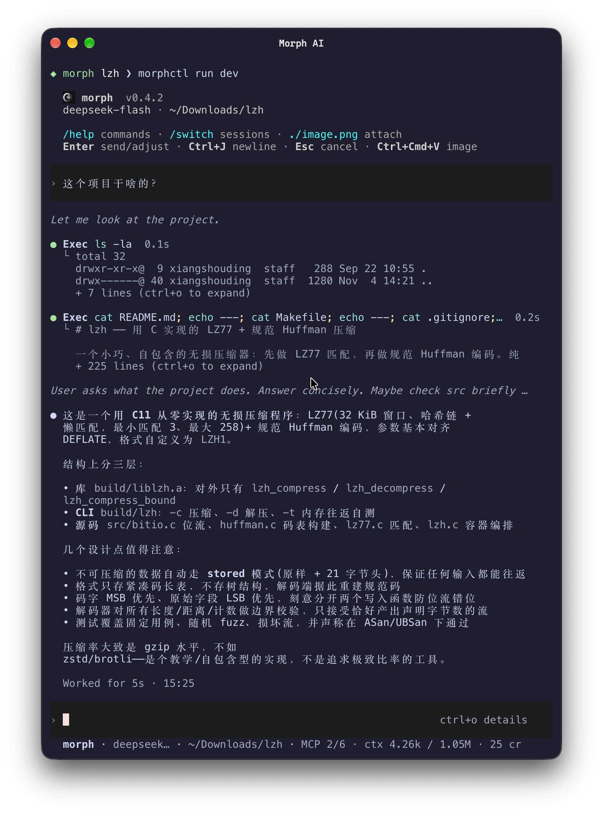

# morph



A terminal-native multimodal AI agent written in pure C. Orchestrates text, image, and video generation and understanding through a ReAct loop.

[中文文档与使用指南](docs/README.md)

## Features

- **Multimodal**: text chat, image generation/editing, and video generation under one entry point
- **ReAct engine**: automatic Thought → Action → Observation orchestration
- **Skills**: instruction packs discovered at startup and activated on demand
- **Extensions**: executable subprocess tools and native shared-library extensions
- **Managed shell**: `exec` parses each command, checks its program set and requested access against the active permission policy, and hands long-running work to the `background` tool
- **Dynamic tools**: create session JavaScript tools on the fly with `tool_create`
- **Scheduled tasks**: recurring or one-shot agent runs deliver to a persistent inbox
- **Local-first**: sessions and artifacts persisted to SQLite, replayable offline

Sandbox, platform policy, extension manifests, and nested-macOS testing: [docs/sandbox.md](docs/sandbox.md).

Bounded file reads, pagination, and encoding handling: [docs/file-read.md](docs/file-read.md).

Sorted directory listing and bounded pagination: [docs/file-list.md](docs/file-list.md).

Unicode decoding, validation, and terminal widths use vendored [utf8proc](docs/unicode.md).

## Windows

Windows 10 version 2004 (build 19041) or later, and Windows 11, x64.
Download and extract the Windows ZIP from [Releases](https://github.com/oxUnd/morph/releases/latest).
The Cygwin runtime is included; no separate Cygwin installation is needed.
Run in Windows Terminal 1.22 or newer for native image previews:

```powershell
.\morph.cmd setup
.\morph.cmd
```

Optional desktop shortcut:

```powershell
powershell -NoProfile -ExecutionPolicy Bypass -File .\install-desktop-shortcut.ps1
```

## Build

Build with CMake ≥ 3.20 and a GCC or Clang toolchain with C11, C++17 and
scope-cleanup support. Install pkg-config and the development files for SQLite3,
libcurl ≥ 7.85 with asynchronous DNS, libuv ≥ 1.44, GNU Readline ≥ 8, zlib, libffi, libwebp, libxml2,
FreeType, HarfBuzz, libvips, Cairo and PangoCairo. A fresh checkout also needs
the MathJax and Markdown source trees at the paths shown below.

On macOS, install the dependencies with Homebrew:

```bash
brew install cmake pkgconf sqlite curl libuv readline zlib libffi webp libxml2 \
  freetype harfbuzz vips cairo pango
```

The JS runner uses only Homebrew's libvips, Cairo and PangoCairo on macOS.
CMake discovers the Homebrew prefix and libvips dependencies, including keg-only
packages such as libarchive; no manual `PKG_CONFIG_PATH` export is needed.
Media paths use stable Homebrew `opt` links. After upgrading dependencies, rerun
`cmake -S . -B build` before rebuilding to refresh cached package metadata.

CMake fetches a pinned post-v0.1.0 nothing-tui revision, including native
text selection, draggable split views, resize pointers, view-owned animations,
grouped, searchable shortcut help with bold key labels, source-preserving tab
alignment, bounded application updates, clean Cygwin console startup, and Windows
Terminal Sixel cell geometry. Use
`-DMORPH_NOTHING_TUI_SOURCE_DIR=/path/to/nothing-tui` to build with a local checkout
of that revision. [nothing-tui source](https://codeberg.org/oxund/nothing-tui/src/commit/0df8e4a6980b1f648e2032c51b5ba147e95ba76b)

CMake also fetches [nothing-orm](https://codeberg.org/oxund/nothing-orm/src/commit/46115ce4b1cae9e1a9b68f52b1f8ebd85c4779a3)
from Codeberg at a pinned revision. SQLite is enabled by default. PostgreSQL
support is optional (`-DENABLE_POSTGRESQL=ON`) and requires libpq development
files. The pinned ORM provides typed Unix-time defaults and controlled
PostgreSQL identity maintenance. Dependency tests and examples are
disabled; regression hooks are built only when `BUILD_TESTS` is enabled.
All persistent models, schema changes, queries, transactions, imports and online
backups live in `src/persistence/orm/`. Runtime, agents, sync and frontends call
these model APIs; they do not use driver handles or execute SQL. Production
models use structured CRUD, query, schema, index and trigger APIs. Raw SQL is
limited to test fixtures and native trigger/default metadata required by the ORM.
The offline
`scripts/audit_session_sync.py` diagnostic uses the built or installed
`morph-session-sync-audit` helper.

Morph, nothing-tui and nothing-orm share one `nbase::nbase` target built from a
pinned post-v0.1.0 nothing revision under the MIT license. Morph uses nbase's HTTP backend
for buffered requests, streaming, multipart uploads and downloads, and its SSE
parser for model and MCP events. Cygwin builds apply the executable-path patch in
`vendor/patches`.
[nothing source](https://codeberg.org/oxund/nothing/src/commit/93e57eeb4855b262f5f5f1c702570c2d55972504)

Instance ownership and the optional mutable-global AST check: [docs/state-ownership.md](docs/state-ownership.md).

The morph-markdown checkout must include [inline math line layout](https://github.com/oxUnd/morph-markdown/commit/785ad7fa38c7d61b0f8b41f1a9a9bc5ea6e213ea)
or a newer revision. Both renderers include their math layout and Windows Terminal
cell-size fixes in source; Morph does not apply local patches to these checkouts.

```bash
git clone https://github.com/oxUnd/mathjax-c vendor/mathjax-c
git clone https://github.com/oxUnd/morph-markdown fronts/morph-markdown
cmake -S . -B build
cmake --build build
cmake --install build --prefix /usr/local   # optional
```

CMake exports `build/compile_commands.json` by default. The project `.clangd`
points clangd-based Vim LSP clients at that database, including the actual nbase,
nothing-tui, nothing-orm and generated-header paths from each CMake target.
For an existing build configured with compilation commands disabled, regenerate it:

```bash
cmake -S . -B build -DCMAKE_EXPORT_COMPILE_COMMANDS=ON
```

Restart clangd in the editor after regenerating the database. If you use a different
build directory, update `CompileFlags.CompilationDatabase` in `.clangd` to match.

Runtime data lives in `share/morph` relative to the executable; the installed
user manual is `share/morph/morph.txt`.

Windows x86-64 builds through Cygwin, runtime bundling, and Wine validation:
[docs/windows-cygwin.md](docs/windows-cygwin.md).

Run tests:

```bash
cmake -S . -B build -DBUILD_TESTS=ON
cmake --build build
cd build && ctest --output-on-failure
```

The PTY regression needs `pexpect` and `pyte`; CTest skips it when unavailable:

```sh
python3 -m venv /tmp/morph-pty-venv
/tmp/morph-pty-venv/bin/pip install pexpect pyte
cmake -S . -B build -DPython3_EXECUTABLE=/tmp/morph-pty-venv/bin/python
cmake --build build
ctest --test-dir build -R cli_pty_integration --output-on-failure
```

## Configuration

Setup chooses model-specific token budgets and timeout values. See the
[setup model defaults](docs/setup-model-defaults.md) for the verified provider
limits, reasoning settings and media presets.

Run `morph` in a terminal with a missing config to start setup. Choose a role, review
its required models and any optional capabilities, then save. Setup exits after
saving. Start Morph again with the same config to begin a conversation. Use
`morph setup` to edit an existing configuration with a backup.
[Setup and reconfiguration](docs/setup.md)

API keys already in environment variables are detected; you can paste a key to
save in `api_key` or name an `api_key_env` instead. Non-interactive runs
(`-p`, JSON events) do not prompt — create the config first or copy the example:

```bash
mkdir -p ~/.morph
cp config.toml.example ~/.morph/config.toml
export OPENAI_API_KEY=sk-...
```

Setup offers OpenAI, Volcengine, DeepSeek and custom endpoints. Adapter support varies by model role. See [setup model defaults](docs/setup-model-defaults.md).

### PostgreSQL storage

Build with `cmake -S . -B build-postgresql -DENABLE_POSTGRESQL=ON`, then
`cmake --build build-postgresql`. SQLite remains available for local databases
and sync metadata. Configure the business database in the same TOML used by the
CLI or FastCGI service:

```toml
[database]
driver = "postgresql"
url_env = "MORPH_DATABASE_URL"
tls_mode = "verify_full"
connect_timeout_ms = 5000
query_timeout_ms = 30000
```

Set `MORPH_DATABASE_URL` in the process environment to a PostgreSQL URL. Credentials
are resolved once and retained by an owned connection configuration; background
workers and child runtimes inherit that configuration. Database URLs are not
expanded as file paths or printed in logs. TLS modes are `verify_full` (default),
`verify_ca`, `require`, and `disable`; `ca_file`, `cert_file`, and `key_file` accept
certificate paths. Use `disable` only for a local isolated test server.

The configured database role must own its application schema or have the permissions
needed to create and migrate tables, indexes, trigger functions, and identity
sequences. Startup applies migrations transactionally. Each database owner retains
one serialized connection; PostgreSQL write transactions update a shared guard
row so existing read/modify/write operations retain their single-writer guarantees.
The execution runtime and workspaces currently belong to one host. Adding a second
execution host requires instance heartbeats and workspace routing.

File sync continues to synchronize configured files and attachments; it omits the
legacy `data.db` primary database entry when PostgreSQL is selected. PostgreSQL
backup and restore use database administration tools rather than the SQLite file
snapshot mechanism. Existing SQLite conversation snapshots can be imported into
PostgreSQL through the normal conversation import service, with ID mapping,
transactional rollback, and revision-based duplicate detection.

Run real PostgreSQL regressions against a dedicated disposable database:

```sh
cmake -S . -B build-postgresql -DENABLE_POSTGRESQL=ON \
  -DMORPH_TEST_POSTGRESQL_URL="$MORPH_TEST_POSTGRESQL_URL"
cmake --build build-postgresql
ctest --test-dir build-postgresql -R postgresql_integration --output-on-failure
```

The PostgreSQL suite is registered only when that URL is configured. It requires a
reachable test database and fails on connection errors; it does not skip tests.
Its local test connection disables TLS. The normal SQLite suite remains registered
in the same build.

## Usage

```bash
./build/bin/morph
```

- `-c <path>`: config file
- `-w <path>`: working directory
- `-p <prompt>`: run one prompt and exit
- `-s <name>`: select or create a named session (with `-p`, reuse the conversation)

Run `morph resume` to open the session list immediately, or `morph resume <name|id>`
to enter an existing session directly. `/resume` opens the same list during chat;
`/resume <name|id>` and `/switch <name|id>` also restore the conversation. Interactive
resumes (including `-s`) restore saved user messages, answers and tool summaries to
the interactive conversation feed, including messages removed from the active model context by
compression. Restoring history does not call the model or execute saved tools.
Sessions remember their working directory: `morph resume <name|id>` restores it
automatically, and an explicit `-w` overrides and rebinds it.
See [session history](docs/cli-history.md) for display and inspection details.

Use `/rewind` to restore code, conversation, or both to a saved turn checkpoint.
See [checkpointing](docs/checkpointing.md) for captured edits, conflict handling,
retention, and the explicit non-interactive commands.

Manage MCP servers and skills directly from the shell, without starting a chat
or configuring a model:

```bash
morph mcp add filesystem -- npx -y @modelcontextprotocol/server-filesystem /tmp
morph mcp add docs --transport http https://example.com/mcp
morph mcp list
morph mcp test docs

morph skills add owner/repo --list
morph skills add owner/repo --skill review
morph skills add git@github.com:owner/repo.git --skill review -g
morph skills update review
morph skills remove review
```

Skills install into the current working directory's `.agents/skills/` by default;
`-g` selects `~/.morph/skills/`, or the configured `[skill].dir`. Project skills
take precedence over user skills. Git sources support `--path` and `--ref`;
local directories also work. `morph skill` aliases `morph skills`.
See [the management command reference](docs/cli-management.md) for selection,
update protection, configuration scope, and all options.

The prompt stays editable while the agent runs. Enter submits a
requirement adjustment for the next loop boundary. Esc applies queued input immediately.
With no queue it interrupts a background wait or cancels the turn. Ctrl+C cancels the turn and stops its commands. Ctrl+J inserts a newline.
Ctrl+T opens the turn's full-screen tool transcript. Pasted and typed
image paths become `[IMAGE#1]` chips (Backspace removes one); `/render <path>`
previews, `/image <path>` attaches.

`/memory` opens the memory inspector: your preferences, saved facts, reusable
tips, past work, unapplied settings, memory updates and a reply memory preview.
Use Up/Down to select a section and Enter to open it. `/` searches; Esc returns
to the section list, then to chat.
The text model uses compact summaries and a memory directory, reading details
on demand; learning and summary updates run in two background stages.
`/memory retry` retries failed updates. `/memory show` retains the text view. See [memory and search](docs/memory.md).

`/copy` copies the current session's latest assistant answer as Markdown, including
code blocks and original whitespace. It also works after resuming a session.
macOS uses `pbcopy`; Linux uses `wl-copy`, `xclip` or `xsel`. Remote terminals can
receive an OSC 52 request, with an explicit unconfirmed-copy receipt.

## Extensions

Extensions install under `[ext].dir` (default `~/.morph/exts`):

```bash
/ext install github:owner/repo
/ext install github:owner/repo@v1.2.0
/ext install github:owner/repo//exts/foo
/ext install https://github.com/owner/repo/tree/main/exts/foo
```

Source format: `github:<owner>/<repo>[@ref][//subdir]`. A package contains
`manifest.toml` or `morph-ext.toml` with `name`, `version`, `type`, `entry`, and
optional `[build] command` (run only after confirmation unless `--yes`).

For implementation, manifests, nbase API discovery, native host-symbol linking,
standalone builds, and verification, see the
[extension development guide](docs/extension-development.md). The bundled
`morph-ext-development` skill follows this guide and includes an offline copy.

## Permissions

`/permissions` opens the permission picker in the input area, keeping the
conversation visible. Applications compose three independent settings; the
default is Ask for approval:

| Preset | access | approval | reviewer |
| --- | --- | --- | --- |
| Ask for approval | workspace | on_request | user |
| Approve for me | workspace | on_request | model |
| Full Access | full | never | user |
| Read Only | read_only | on_request | user |

`/permissions mode auto` selects a preset. `/permissions set read_only never user`
selects a custom policy. Changes save to the active configuration and update the
idle runtime; active turns, subagents or process sessions must finish first.

The status bar shows the applied mode as `perm: ask`, `auto`, `full`, or
`read_only`; custom policies include their three dimensions at standard widths.
`/permissions status` reports the effective policy, and `list`, `revoke`, `clear`
retain persistent grant management. Read Only can request explicit upgrades;
`approval=never` rejects requests outside existing authority. Automatic review
uses an isolated model client and falls back to human review on failure or defer.

See [the design](docs/permissions-design.md) and
[acceptance evidence](docs/permissions-acceptance.md) for integration and migration.

[Guardrails and task evidence](docs/guardrails.md) describes final-answer validation,
artifact checks, optional completion verification and contextual action monitoring.

## Layout

```
src/
  permission/   Shared access/approval/reviewer policy, grants and review routing
  agent/        ReAct loop, context compression, tool dispatch
  agent/tools/  Built-in tools (credits, memory, img_gen, vid_gen, ...)
  runtime/      Process-level owner: lifecycle, sessions, turns, tasks, MCP
  exec/         Managed process sessions behind the exec and background tools
  event/        Unified event sink shared by all frontends
  js_runner/    Embedded QuickJS runtime for dynamic tools
  persistence/orm/  All persistent models, queries, schema and database maintenance
  models/       LLM / image / video backends
  skill/        Skill discovery, parsing, and activation
  sync/         Session synchronisation
  sapi/         Front-ends: CLI and FastCGI
  ext/          Ext loading and management
  sandbox/      Sandboxed ext execution
  ipc/          JSON-RPC
  render/       Markdown / image / video terminal rendering
fronts/         Extra front-end libraries (morph-markdown)
exts/           Example exts (manifest.toml + entry script)
vendor/         Third-party sources, assets and downstream patches (cJSON, stb, MathJax)
```

See the [documentation index](docs/README.md) for feature guides and [AGENTS.md](AGENTS.md) for development conventions.

Lifecycle command hooks and review/trust configuration: [Hooks](docs/hooks.md).
