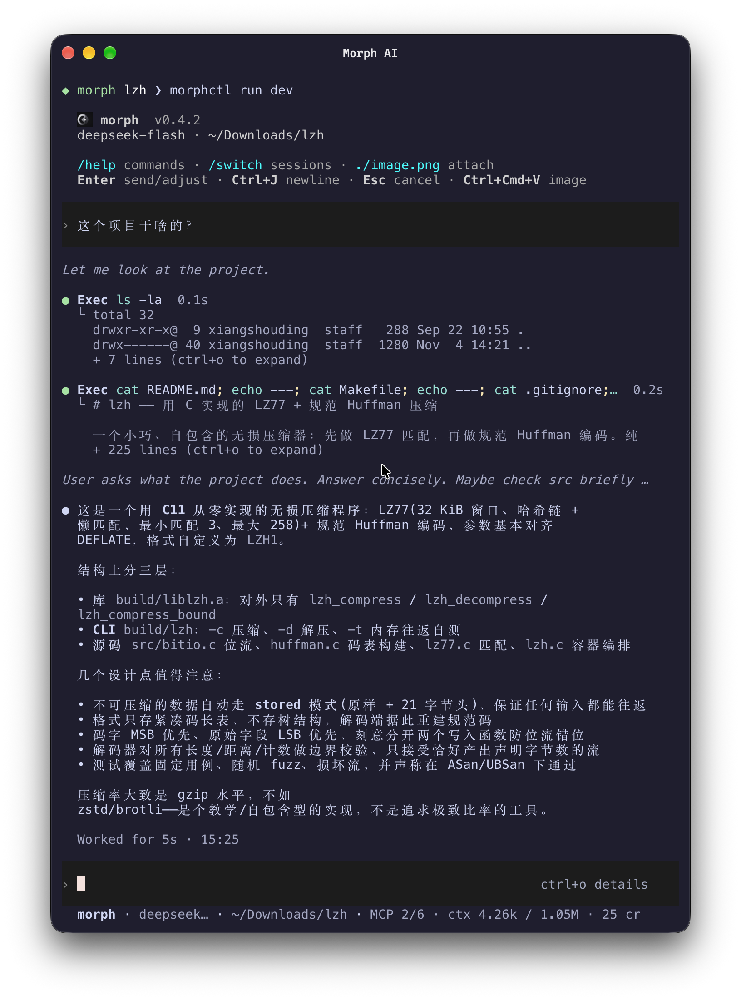

# morph



A terminal-native multimodal AI agent written in pure C. Orchestrates text, image, and video generation and understanding through a ReAct loop.

中文系统介绍: [docs/archive/introduction.zh-CN.md](docs/archive/introduction.zh-CN.md)

## Features

- **Multimodal**: text chat, image generation/editing, and video generation under one entry point
- **ReAct engine**: automatic Thought → Action → Observation orchestration
- **Skills**: hot-loadable instruction packs (SKILL.md)
- **Extensions**: hot-pluggable, sandboxed, any language
- **Managed shell**: `exec` parses each command, asks approval scoped to the programs it would run, and hands long-running work to `process` sessions
- **Dynamic tools**: create session JavaScript tools on the fly with `tool_create`
- **Scheduled tasks**: recurring or one-shot agent runs deliver to a persistent inbox
- **Local-first**: sessions and artifacts persisted to SQLite, replayable offline

Sandbox, platform policy, extension manifests, and nested-macOS testing: [docs/sandbox.md](docs/sandbox.md).

Bounded file reads, pagination, and encoding handling: [docs/file-read.md](docs/file-read.md).

Sorted directory listing and bounded pagination: [docs/file-list.md](docs/file-list.md).

Unicode decoding, validation, and terminal widths use vendored [utf8proc](docs/unicode.md).

## Build

Requirements: CMake ≥ 3.20, SQLite3, libcurl ≥ 7.84, libuv ≥ 1.44, libffi, libwebp, libxml2, and
[mathjax-c](https://github.com/oxUnd/mathjax-c). Optional: readline.

Instance ownership and the optional mutable-global AST check: [docs/state-ownership.md](docs/state-ownership.md).

```bash
git clone https://github.com/oxUnd/mathjax-c vendor/mathjax-c
git clone https://github.com/oxUnd/morph-markdown fronts/morph-markdown
cmake -S . -B build
cmake --build build
cmake --install build --prefix /usr/local   # optional
```

Runtime data lives in `share/morph` relative to the executable; the installed
user manual is `share/morph/morph.txt`.

Run tests:

```bash
cmake -S . -B build -DBUILD_TESTS=ON
cmake --build build
cd build && ctest --output-on-failure
```

The PTY regression needs `pexpect` and `pyte`; CTest skips it when unavailable:

```sh
python3 -m venv /tmp/morph-pty-venv
/tmp/morph-pty-venv/bin/pip install pexpect pyte
cmake -S . -B build -DPython3_EXECUTABLE=/tmp/morph-pty-venv/bin/python
cmake --build build
ctest --test-dir build -R cli_pty_integration --output-on-failure
```

## Configuration

Setup chooses model-specific token budgets and timeout values. See the
[setup model defaults](docs/setup-model-defaults.md) for the verified provider
limits, reasoning settings and media presets.

Run `morph` in a terminal; a missing config triggers an interactive wizard
(↑/↓ choose, Enter select, Esc back, Ctrl-C/Ctrl-D cancel). Provider presets
fill in model and API URL. Vision, image generation, and video generation are
independent optional steps. The config is saved to `~/.morph/config.toml`
(owner-only, 0600), or the path from `-c`; existing files are never overwritten.

API keys already in environment variables are detected; you can paste a key to
save in `api_key` or name an `api_key_env` instead. Non-interactive runs
(`-p`, JSON events) do not prompt — create the config first or copy the example:

```bash
mkdir -p ~/.morph
cp config.toml.example ~/.morph/config.toml
export OPENAI_API_KEY=sk-...
```

Supported providers: `openai`, `volcengine`, `deepseek`.

## Usage

```bash
./build/bin/morph
```

- `-c <path>`: config file
- `-w <path>`: working directory
- `-p <prompt>`: run one prompt and exit
- `-s <name>`: select or create a named session (with `-p`, reuse the conversation)

Run `morph resume` to open the session list immediately, or `morph resume <name|id>`
to enter an existing session directly. `/resume` opens the same list during chat;
`/resume <name|id>` and `/switch <name|id>` also restore the conversation. Interactive
resumes (including `-s`) restore saved user messages, answers and tool summaries to
terminal scrollback, including messages removed from the active model context by
compression. Restoring history does not call the model or execute saved tools.
See [session history](docs/cli-history.md) for display and inspection details.

Manage MCP servers and skills directly from the shell, without starting a chat
or configuring a model:

```bash
morph mcp add filesystem -- npx -y @modelcontextprotocol/server-filesystem /tmp
morph mcp add docs --transport http https://example.com/mcp
morph mcp list
morph mcp test docs

morph skills add owner/repo --list
morph skills add owner/repo --skill review
morph skills add git@github.com:owner/repo.git --skill review -g
morph skills update review
morph skills remove review
```

Skills install into the current working directory's `.agents/skills/` by default;
`-g` selects `~/.morph/skills/`, or the configured `[skill].dir`. Project skills
take precedence over user skills. Git sources support `--path` and `--ref`;
local directories also work. `morph skill` aliases `morph skills`.
See [the management command reference](docs/cli-management.md) for selection,
update protection, configuration scope, and all options.

With readline, the prompt stays editable while the agent runs: Enter submits a
requirement adjustment, Esc/Ctrl+C cancels, Ctrl+J or Alt+Enter inserts a
newline. Ctrl+O opens the turn's full-screen tool transcript. Pasted and typed
image paths become `[IMAGE#1]` chips (Backspace removes one); `/render <path>`
previews, `/image <path>` attaches.

`/copy` copies the current session's latest assistant answer as Markdown, including
code blocks and original whitespace. It also works after resuming a session.
macOS uses `pbcopy`; Linux uses `wl-copy`, `xclip` or `xsel`. Remote terminals can
receive an OSC 52 request, with an explicit unconfirmed-copy receipt.

## Extensions

Extensions install under `[ext].dir` (default `~/.morph/exts`):

```bash
/ext install github:owner/repo
/ext install github:owner/repo@v1.2.0
/ext install github:owner/repo//exts/foo
/ext install https://github.com/owner/repo/tree/main/exts/foo
```

Source format: `github:<owner>/<repo>[@ref][//subdir]`. A package contains
`manifest.toml` or `morph-ext.toml` with `name`, `version`, `type`, `entry`, and
optional `[build] command` (run only after confirmation unless `--yes`).

## Permissions

`/permissions` opens the permission picker. Applications compose three independent
settings; the default is Ask for approval:

| Preset | access | approval | reviewer |
| --- | --- | --- | --- |
| Ask for approval | workspace | on_request | user |
| Approve for me | workspace | on_request | model |
| Full Access | full | never | user |
| Read Only | read_only | on_request | user |

`/permissions mode auto` selects a preset. `/permissions set read_only never user`
selects a custom policy. Changes save to the active configuration and update the
idle runtime; active turns, subagents or process sessions must finish first.
`/permissions status` reports the effective policy, and `list`, `revoke`, `clear`
retain persistent grant management. Read Only can request explicit upgrades;
`approval=never` rejects requests outside existing authority. Automatic review
uses an isolated model client and falls back to human review on failure or defer.

See [the design](docs/permissions-design.md) and
[acceptance evidence](docs/permissions-acceptance.md) for integration and migration.

## Layout

```
src/
  permission/   Shared access/approval/reviewer policy, grants and review routing
  agent/        ReAct loop, context compression, tool dispatch
  agent/tools/  Built-in tools (credits, memory, img_gen, vid_gen, ...)
  runtime/      Process-level owner: lifecycle, sessions, turns, tasks, MCP
  exec/         Managed process sessions behind the exec and process tools
  event/        Unified event sink shared by all frontends
  js_runner/    Embedded QuickJS runtime for dynamic tools
  persistence/  Persistent stores for memory and credit queries
  models/       LLM / image / video backends
  skill/        Skill discovery, parsing, and activation
  sync/         Session synchronisation
  sapi/         Front-ends: CLI and FastCGI
  db/           SQLite schema, sessions, permission grants
  ext/          Ext loading and management
  sandbox/      Sandboxed ext execution
  ipc/          JSON-RPC
  render/       Markdown / image / video terminal rendering
fronts/         Extra front-end libraries (morph-markdown)
exts/           Example exts (manifest.toml + entry script)
vendor/         Third-party libraries (cJSON, stb_image, toml)
```

See [AGENTS.md](AGENTS.md) for conventions and [docs/REQUIREMENTS.md](docs/REQUIREMENTS.md) for the full spec.

Lifecycle command hooks and review/trust configuration: [Hooks](docs/hooks.md).
