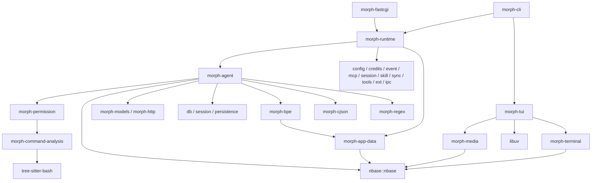

# nothing / nbase 全量替换评估与计划

- 日期：2026-11-14。
- 状态：原生 API 迁移、旧库删除及再审 A01–A06、M01–M08 已逐项处理；有意保留的兼容与安全边界、最终验证见第 13 节。nbase 主库许可仍待明确。
- morph 基线：`df7ca5a4cb4cc9d79713d4de17eff6c576f465f2`。
- nbase 基线：`cd7efa88aa5c3bbd3825d45d3527e45d7566b716`，版本 `0.1.0`。
- 上游：[oxund/nothing](https://codeberg.org/oxund/nothing)。仓库名为 nothing，
  实际库名、API 前缀和 CMake target 分别是 nbase、`nb_`、`nbase::nbase`。
- 第 1–6 节保留迁移前的评估依据与原始路径，部分旧文件已删除；
  第 7、9、10 节保留原交付记录；第 12 节保留问题发现记录，最终修复与验收以第 13 节为准。

## 1. 评估目标与结论

**终态是移除 `morph-util`，全仓直接采用 nbase 的类型和 API，并收敛散落在各模块
中的重复基础逻辑。** 在 `src/util` 内转调 nbase、保留 `morph_buf_t` 等旧类型，
或者把 util 整体搬到另一个目录，都不算完成。

初评时 nbase 已具备多数容器、编码、哈希、文件、线程和进程原语，适合作为替换基础。
基线仍不能无差别替换：专项探针已复现 nbase 路径解析的堆越界，文件复制存在整文件
内存加载；Unicode、侵入式队列、C++17 接口，以及进程启动与 I/O 契约存在缺口。
改动还涉及错误模型、资源所有权、日志、TOML、线程同步和构建依赖。
这是一次跨模块重构，不是函数重命名任务。

逻辑层面已经确认多组重复实现：原子写入、文件复制/递归删除、单调时间、流式参数
拼接、行缓冲消费、编码/哈希、子进程管理和路径边界检查。其中部分重复代码的
行为已经分叉。迁移应统一机制，同时明确保留必要的业务规则。

评估方式是全仓静态检索、热点函数逐段阅读、上游独立构建及语义探针。
本文不声称已经逐行审阅全部调用点，也不把上游测试通过等同于 morph 集成通过。

## 2. 迁移前基线验证

初次源码导入 `vendor/nothing/`，采用固定提交的完整 `git archive` 快照，共 843 个文件，
当时与该提交逐文件比较均一致；没有嵌套 `.git`，尚未接入 morph 的构建。
`README.morph.md` 是另加的来源说明。

环境：macOS 27.0.1 / arm64，AppleClang 21.0.0，CMake 4.4.4。

| 验证项 | 实测结果 | 说明 |
| --- | --- | --- |
| Debug、`NB_WERROR=ON` | 构建通过，21/21 CTest 通过 | 含库测试、TOML 语料和 19 个示例 |
| ASan/UBSan、`NB_WERROR=ON` | 构建通过，21/21 CTest 通过 | 当前执行路径未报告 sanitizer 错误 |
| TOML 语料 | valid 218/218；invalid 502/502 | 测试检查接受/拒绝，不是 AST 值的完整差分验证 |
| 追加 morph 的 `-Wshadow -Wconversion -Werror` | 静态库构建通过 | 此项关闭了上游测试和示例，只验证库源码 |
| 严格 C++17 公共头 | 19/23 通过，4 个失败 | `thread.h`、`cancel.h`、`cleanup.h`、`nbase.h` 使用/引入 C11 `_Atomic` |
| 严格 C++17 字符串宏 | 失败 | 实际展开 `NB_STR_LIT` / `NB_STR_NULL` 时使用 C99 compound literal |
| 容器/字符串语义探针 | 发现差异 | 见第 4 节 |
| Unicode 标量宽度差分 | 47,035 个标量不同 | 包含未分配码点，不能解读为这么多实际字符都显示错误 |
| 补充长路径 ASan 探针 | 失败，heap-buffer-overflow | 有效输入路径 344 字节，见下文；说明现有测试覆盖存在遗漏 |

### 必须先修复的上游实现问题：realpath 缓冲容量

[`nb_platform_path_canonical`](../vendor/nothing/src/platform/posix/path.c:72)
先分配 256 字节，再调用 `realpath(path, resolved)`。这个调用没有缓冲容量参数，
并不会按这 256 字节截断或可靠地通知“需扩容”；事后检查 ENAMETOOLONG 再翻倍
不能防止第一次写越界。

用仓库外临时目录构造三段各 100 字节的目录名，再调用公共 `nb_path_canonical`，
ASan 复现结果如下。输入路径 344 字节，macOS 解析 `/tmp` 后的规范路径更长：

```text
AddressSanitizer: heap-buffer-overflow
WRITE of size 353
  realpath
  nb_platform_path_canonical path.c:90
  nb_path_canonical path.c:411
  main path-probe.c:10
0 bytes after 256-byte region
  allocated by nb_platform_path_canonical path.c:83
```

**处理要求：** 上游改用平台保证足够容量的方案，或获取系统分配的结果后正确配对
释放；增加长路径、解析失败和借用输出的回归。该基线不能直接作为生产路径解析后端。
实施阶段已修复并加入长路径回归，最终平台证据见第 10 节。最小调用是初始化 `nb_buf/nb_err` 后执行
`nb_path_canonical(&out, long_existing_path, &err)`；探针链接了本次 ASan 版 nbase。

独立构建可以从项目根目录复现；构建目录放在仓库外：

```sh
cmake -S vendor/nothing -B /tmp/morph-nbase-debug \
  -DCMAKE_BUILD_TYPE=Debug -DNB_WERROR=ON
cmake --build /tmp/morph-nbase-debug -j 8
ctest --test-dir /tmp/morph-nbase-debug --output-on-failure

cmake -S vendor/nothing -B /tmp/morph-nbase-asan \
  -DCMAKE_BUILD_TYPE=Debug -DNB_WERROR=ON -DNB_SANITIZE=ON
cmake --build /tmp/morph-nbase-asan -j 8
ctest --test-dir /tmp/morph-nbase-asan --output-on-failure

cmake -S vendor/nothing -B /tmp/morph-nbase-strict \
  -DCMAKE_BUILD_TYPE=Debug -DNB_WERROR=ON \
  '-DCMAKE_C_FLAGS=-Wshadow -Wconversion' \
  -DNB_BUILD_TESTS=OFF -DNB_BUILD_EXAMPLES=OFF
cmake --build /tmp/morph-nbase-strict -j 8
```

这些初评探针只覆盖 macOS。实施后的 Linux、MinGW/Wine、Valgrind、
morph 完整回归和性能基准见第 10–11 节；iOS/Android 未实测。
本轮没有变更 morph 执行路径，不为其声明迁移后的验证结果。

## 3. 重复逻辑审阅：应当删掉什么，统一到哪里

以下结论来自实现逻辑对比，不只依据函数名相似。

### D01：多份原子文件发布实现，持久性和安全语义不同

位置：

- [`file_write_atomic`](../src/util/file.c)：同目录临时文件、完整写入、文件 fsync、
  rename、父目录 fsync；新文件 0600，拒绝符号链接。
- [`cli_management_atomic_write`](../src/sapi/cli/services/management.c:114)：
  同样执行临时文件、写循环、fsync 和 rename，但没有父目录 fsync，使用 stat 读取模式。
- [`atomic_write_config`](../src/agent/tools/config_write.c:211)：
  再实现一遍写循环/临时文件/模式/rename，没有父目录 fsync。
- [`cli_wizard_save_config`](../src/sapi/cli/pages/setup/wizard.c)：
  支持 create-only 的 link 发布、覆盖 rename、父目录 fsync，另外报告是否已经发布。
- [`cli_share_store_share_publish`](../src/sapi/cli/services/share_store.c)：
  临时文件完整写入后 link 为最终文件名，另有失败回收。

**收敛方式：** 这些地方直接使用 `nb_file_write_all_atomic`，由调用方提供 mode、
create-only 等业务选项；删除本地写循环和通用发布实现。
配置编辑的授权、锁、内容冲突检查，setup 的用户选择，share 的文件命名继续由业务负责。

**缺口：** nbase 新文件默认 0644，不能直接用默认选项写敏感配置。
`mode=0` 同时表示“保留已有模式/新建用 0644”；应明确新建模式与保留模式的组合。
setup 依赖“rename 已成功但父目录同步失败”的已发布状态，而 nbase 当前只有返回码，
没有对应状态出参；需要扩展原 API 的结果表达再删除本地实现。
checkpoint 的目录 fd / `openat` / `O_NOFOLLOW` 恢复流程属于更强的目录约束，
不能退化为字符串路径原子写入。

### D02：复制、递归遍历和删除在安装及同步中重复实现

位置：[`ext/install.c`](../src/ext/install.c:331) 的 `copy_file/copy_tree/remove_tree`、
[`skill_store.c`](../src/sapi/cli/services/skill_store.c:138) 的文件/目录复制与递归删除、
[`sync.c`](../src/sync/sync.c:794) 的 `copy_file_plain`、
[`db_backup.c`](../src/sync/db_backup.c:111) 的 `copy_plain`。

同步中的两份 plain copy 都是 fopen/fread/fwrite/flush/close 的同类实现。
安装逻辑也是重复的 read/write、EINTR 处理和目录遍历，但策略不同：
ext 复制保留 symlink、跳过 `.git`；skill 复制要求链接留在源根内，设置递归深度上限，
使用 no-follow/create-only；覆盖、权限、特殊文件处理也不同。

**收敛方式：** 普通复制直接使用 `nb_file_copy`，删除用 `nb_file_remove_all`。
目录遍历机制需要在 nbase 补齐过滤/深度/链接处理的可表达能力，或者由业务遍历
`nb_dir` 并调用 nbase 的单项复制；业务层不能再保留 read/write 复制内核。
包过滤、skill 根约束和事务回滚留在各自业务中。
SQLite 在线备份继续使用 SQLite backup API，不能用普通文件复制代替。

**额外实现缺口：** 所读 POSIX `copy_regular_file` 先 `nb_file_read_all`，再执行
原子写入，把整份源文件装入内存；现有几份 plain copy 使用固定大小缓冲流式复制。
因此不能只因为 nbase 有 copy API 就直接替换大文件同步。需先在 nbase 实现有界内存
的流式复制/临时文件发布，并验证大文件、磁盘满、取消及失败回收。
该差异是初评中源码确认的复杂度变化；最终测量的 RSS 与场景耗时见第 11 节。

### D03：时间读取与 deadline 换算重复，单位和失败处理分叉

位置：[`process_now_ms`](../src/exec/process.c:112)、
[`mcp_stdio_now_ms`](../src/mcp/mcp_stdio.c:27)、
[`runtime_mcp_now_ms`](../src/runtime/mcp_background.c:11)、
[`hook_now_ms`](../src/runtime/hooks_executor.c:142)、
[`cli_jobs_now`](../src/sapi/cli/models/jobs.c:8)、
[`cli_transcript_now`](../src/sapi/cli/services/transcript.c)、
[`morph_io_now_ms`](../src/util/child_io.c:52) 等。

这些实现反复读取 `CLOCK_MONOTONIC` 再转换成整数毫秒或浮点秒；有的检查失败，
有的不检查，返回类型也有 signed/unsigned 差异。各等待循环还重复计算剩余时间。

**收敛方式：** 直接读取 `nb_time_monotonic_ns`，deadline 统一采用明确单位；
展示层在格式化时换算，不能误用读取墙钟的 `nb_time_now_ms`。
deadline 的饱和相加、剩余超时裁剪若反复需要，应补进 nbase 的时间原语。
业务仍决定超时预算、轮询节奏、kill grace 和状态转换。

### D04：模型流式参数有两套相同的扩容与追加算法

[`chat_codec.c`](../src/models/llm/chat_codec.c:195) 和
[`responses_append_call_input`](../src/models/llm/responses_codec.c:146)
都在每个 delta 上执行 strlen、加法溢出检查、realloc、memcpy、NUL 终止。
[`stream.c`](../src/models/llm/stream.c) 还手动增长 tool-call 数组。

**收敛方式：** tool-call 的累积 arguments 使用原生 `nb_buf`，列表使用 `nb_vec`，
两种 provider codec 使用同一领域对象的追加操作或直接追加到对象的 nbase 字段。
删除两份字符串增长算法，避免按片段反复扫描完整前缀。
provider 的 item-id/call-id 路由规则仍各自负责；不能为了合并缓冲而合并协议状态机。

### D05：流式输入反复“找换行、复制行、移动余下内容”

[`mcp_stdio_recv`](../src/mcp/mcp_stdio.c:35) 每读一行后 memmove 剩余缓冲；
[`http/sse.c`](../src/http/sse.c:100) 自行维护未完成行并移动尾部；
[`exec/process.c`](../src/exec/process.c) 也有 pending/tail 的手动压缩逻辑。

**收敛方式：** 使用 `nb_buf` 的读游标、`nb_buf_next_line`、consume/compact，
在消费时减少重复搬移。SSE 的空行分派、多条 data 合并、id/retry、CRLF 规则，
MCP 的请求匹配与最大帧限制，exec 的有界尾部保留策略都继续属于各自协议。
借用行在 append/compact 后可能失效，回调保存数据时必须明确复制。

### D06：编码、摘要与比较不仅在 util 内重写

- [`fastcgi/security.c`](../src/sapi/fastcgi/security.c) 另有 Base64 decoder、HMAC-SHA256、
  hex 编解码和常量时间比较；util 中又有 Base64 和 SHA-256。
- [`runtime/hooks.c`](../src/runtime/hooks.c:29) 和
  [`cli/commands/hooks.c`](../src/sapi/cli/commands/hooks.c) 都把工作目录做 SHA-256 再手写 hex。
- [`sync/content_hash.c`](../src/sync/content_hash.c:8)、`util/id.c`、`skill_store.c`、
  `runtime/session_import.c` 等也手写相同的逐字节 hex 编码。
- [`mcp_http.c`](../src/mcp/mcp_http.c:92) 和 `render/video.c` 都有 percent 编码，
  后者处理 file URL 路径时额外保留 `/`。

**收敛方式：** 直接使用 `nb_base64_*`、`nb_sha256_*`、`nb_hmac_sha256`、
`nb_hex_*`、`nb_hash_equal` 和 `nb_url_encode`，删除局部算法。
hooks 的 review-token 算法由 runtime 提供一个有业务含义的查询入口，CLI 不再重算。
文件 URL 按路径分段编码并保留分隔符，不能把 query encoder 原样套在整条路径上。

**行为边界：** nbase Base64 接受空白和无 padding，现有 decoder 的接受集合不同，
不能意外放宽认证输入；认证格式应保留显式校验规则，并列出有意的校验收紧。
nbase 不提供 PBKDF2，密码格式/迭代策略继续由认证模块负责，内部调用 nbase HMAC。
同步的 BLAKE3 内容标识继续使用 BLAKE3，不替换成 SHA-256 改变既有数据协议。

### D07：子进程启动、等待、管道和取消逻辑多头维护

位置：`util/child_io.c`、`exec/process.c`、`mcp/mcp_stdio.c`、`ext/ext.c`、
`ext/install.c` 的 `run_cmd/wait_child`、`cli/services/management.c` 的
`cli_management_run`、`render/video.c`、`cli/adapters/clipboard/clipboard.c`、
`agent/tools/dynamic_tool_runner.c` 等。

已读实现反复执行 pipe/fork/dup2/关闭端点、exec、EINTR waitpid、退出状态解释。
长期 session、有限 exchange、交互 PTY 的生命周期不同，部分工具还要求受限环境、
进程组终止、超时后排空输出、SIGPIPE 隔离和子进程信号恢复。

**收敛方式：** 通用启动与 I/O 机制采用 nbase；`morph-exec` 保留 session/job、
输出脱敏/落盘、事件和 runtime 集成等领域职责。
不能把当前 `child_io.c` 原封不动搬到 exec 后声称去重完成。

**nbase 当前缺口：** spawn 不搜索 PATH；标准流固定为管道，缺少继承/null/重定向
配置；公开接口无取消式双向 exchange；stdin_write 是阻塞完整写入；没有 PTY、
sandbox/pre-exec 配置入口。所读 POSIX child_setup 没有恢复 morph 屏蔽的信号集合。
这些能力需在上游原语或明确的平台接口补齐；回调必须约束 fork 后可调用内容。
只替换普通进程而永久留几套受限进程底层实现，不满足这次收敛目标。

### D08：路径包含判定重复，已存在与尚不存在路径的语义不一致

[`path_within_root`](../src/sapi/fastcgi/handlers/artifacts.c:27) 和
[`relative_under_root`](../src/sapi/fastcgi/presentation/media_refs.c:61)
都执行两次 realpath，再做前缀比较和 `/` 边界判断；`util/file.c` 又实现一份
包含判断，且对不存在路径尝试解析父目录。
[`scope_path_copy`](../src/agent/agent_control.c) 则逐级寻找最近存在的祖先。

**收敛方式：** 已存在路径使用 nbase canonical/within；新建目标的安全解析需要
nbase 补齐“已存在祖先 + 未创建尾部”的显式契约，不能用 lexical clean 冒充解析。
authorization 的 allow/deny、grant、工作区边界等决策保留在 permission。
checkpoint 的 fd-relative 无跟随遍历不能替换成 realpath 后再 open 的弱化流程。

另一个逻辑重复是 `permission/context.c:path_is_default_temporary` 与
`sandbox/sandbox.c:sandbox_resolve_custom_temp`：都校验 TMPDIR 是已存在绝对目录，
不是 `/`，且不会包含 HOME。nbase 提供路径机制；共享的“可信临时目录”策略应由
permission 统一产出给 sandbox 消费，避免两套许可边界持续分叉。

### D09：数组删除、入队出队也在调用方手工操作存储

`persistence/checkpoint_store.c`、`tui/render/native_media.c`、`tui/core/view.c`、
`cli/services/command_job.c` 等通过 memmove 调整数组并更新元素计数；
`exec/process.c`、`runtime/sync.c` 还自己维护数组容量与 realloc。

**收敛方式：** 由 `nb_vec_insert/remove/reserve` 管理存储变化，业务对象先释放被移除
元素拥有的资源；不把所有 memmove 都当成重复，编辑器的文本区间编辑仍是领域算法。
agent-control/event queue 的侵入式队列需要 nbase 提供对应原语；不能用简单 vector
代替后悄悄改变稳定地址、复杂度和持锁期间行为。

## 4. nbase 还差什么，以及现有契约怎样改变

| 项目 | 当前差异/缺口 | 全量迁移需要的处理 |
| --- | --- | --- |
| 缓冲区 move | morph 清理目标并清空源；nbase 交换两边 | 所有调用点按真正需要的 transfer/swap 改写，不保留旧包装 |
| 空缓冲区 detach | 已分配的空 morph buffer 可返回空字符串；nbase 返回 NULL | 调用方区别空内容和失败；所有权结果优先直接持有 `nb_buf` |
| 缓冲区错误 | morph 是负错误码 sticky 状态；nbase 是 bool sticky 状态 | 全仓改检查方式和返回值语义，不能机械替换 `if (rc)` |
| 字符串比较 | morph 优先比较长度；nbase 是字典序 | 探针 `z` 对 `aa` 分别为 -1/+1；逐个确认排序/查找意图 |
| 结构体布局 | str 的字段顺序/名称不同，buf 增加 off，map 改成不透明指针 | 修改字段、初始化、持有方式和公开头；禁止 typedef/布局强转兼容 |
| 数组初始化 | nbase push 返回未初始化元素；morph 头声称 zeroed，但所读实现没有清零 | 按构造逻辑审计每个新 slot；不把旧文档当作真实保证 |
| map 所有权 | nbase 可安装 value dtor，del/replaced 仍交给调用方 | 明确唯一所有者，禁止调用方和 dtor 重复释放 |
| cleanup | nbase 有 `NB_CLEANUP`，不支持的编译器会静默空展开 | 保留强制编译器能力检查；补齐实际需要的 typed cleanup/steal 原语 |
| 分配/释放 | nbase 按 `nb_free(ptr,size)` 配对，detached buffer 还需 cap | 改拥有类型和释放路径；不能将 nb storage 当作任意 malloc 字符串转交 |
| OOM | `nb_alloc` 默认 abort，`nb_try_*` 和所读容器可返回失败 | 可恢复执行路径使用 fallible API，不引入进程级 OOM 策略修改 |
| 错误模型 | morph 是负 errno/领域码；`NB_ERR_INVAL=-1` 等不对应 errno | 通用错误采用 `nb_status/nb_err`，领域码按 `NB_ERR_USER` 分段；协议旧码只在协议边界转换 |
| 取消状态码 | 有 `nb_cancel`，但当前 `nb_status` 无 cancelled 状态 | 为取消式进程/I/O 明确基础状态，不能把取消混同 timeout 或普通 I/O 失败 |
| 线程/锁/条件变量 | morph 多处内嵌 pthread 对象；nbase 用不透明指针，cond timedwait 以 bool 合并超时/错误 | 改每个 owner 的创建/销毁/失败回收，补齐必须区分的等待结果；不是替换 pthread 符号即可 |
| Unicode | nbase 缺少当前所需 category/casefold，width 数据不同 | 先补 nbase 的完整 Unicode 能力，再删除 morph Unicode 基础实现 |
| 侵入式队列 | nbase 没有当前 queue 的等价模块 | 在 nbase 补原语，替换所有队列节点、宏和操作 |
| C++17 | `_Atomic` 类型和 C99 literal 宏严格检查失败 | 修公共头与 C/C++ ABI 契约，新增真实类型/宏用法编译验证 |
| 日志 | nbase 无当前文件轮转；默认 sink 是 stderr，记录有长度限制 | 上游补文件 sink/长度能力，或 runtime 拥有文件 sink；全仓直接 `nb_log_*` |
| 文件/路径 | 原子写发布状态、私有新文件模式、缺失路径解析及目录策略不足 | 见 D01/D02/D08；在上游补机制，业务提供明确策略 |
| 长路径安全 | `realpath` 写入 256 字节分配块，已复现堆越界 | 先修上游，再接入所有 canonical/within 使用点 |
| 文件复制内存 | POSIX copy 把整个文件装入内存 | 先补流式复制/发布机制，避免替换后大文件同步的内存退化 |
| 进程 | 缺取消式 exchange、标准流选项、PTY、子进程隔离入口等 | 见 D07，补齐后再收敛受限执行路径 |
| TOML | nb_toml 是只读 AST，返回借用的有长度字符串；现有代码访问 tomlc17 具体布局 | 重写 config/schema/edit、ext manifest、skill 等所有消费者及借用生命周期 |

Unicode 差分方法：遍历 `0..0x10FFFF`，跳过 surrogate，比较现有
`utf8_codepoint_width` 与 `nb_utf8_width_cp`，共 1,112,064 个标量。
除未分配码点外，实测 `U+0897` 宽度为 morph 0 / nbase 1，
`U+1FAE9`、`U+1FAEA` 为 morph 2 / nbase 1。不能直接接管终端布局。
建议在 nbase 补齐版本明确的 Unicode 数据或可选 utf8proc 后端及 category/casefold
接口；TUI 只保留 ANSI 解析、终端净化、裁剪等领域策略，并直接使用 `nb_utf8_*`。

通用错误模型迁移也必须覆盖原来直接返回/比较 `-errno` 的实现，不只搜索
`morph_err_t`。系统诊断保存于 `nb_err.os_errno`；原有网络/协议/数据库状态需要
明确映射。日志 null 禁用、实例隔离、文件输出和 shutdown 顺序必须保持。
不采用 nbase 的默认 logger 单例，不在运行中切换全局 allocator。

替换范围还包括散落在 util 外的通用平台原语。当前 `src` 中检索到 71 个使用
pthread thread/mutex/cond 类型或操作的文件；其 owner 要直接改用 `nb_thread`、
`nb_mutex`、`nb_cond`，而不是留一套应用自建线程基础层。
事件循环仍使用 libuv，信号订阅和隔离代码按平台职责处理。
条件变量必须保留谓词循环和 stop/join 顺序；heap handle 的分配失败现在也是初始化
失败路径。`nb_poll` 的超时返回码与 POSIX poll 的 0 不同，也必须重写调用点判断。

## 5. 现有 util 文件的最终去向

| 当前文件/职责 | 替换或归属 |
| --- | --- |
| `buf.*`、`array.*`、`str.*`、`strmap.*` | 全部调用方改用 `nb_buf/nb_vec/nb_str/nb_map`，删除旧模块 |
| `queue.h`、`cleanup.h` | 使用补齐后的 nbase queue 和 `NB_CLEANUP`；领域对象保留自己的 typed cleanup |
| `error.*` | 使用 nbase 错误框架；领域描述表归所属模块；删除旧通用错误框架 |
| `log.*` | `nb_log`；文件 sink/轮转由上游或 runtime 的具体输出服务拥有，不建立兼容日志层 |
| `file.*` | `nb_file/nb_path/nb_dir`，含补齐的通用能力；业务不再保存复制/发布内核 |
| `base64.*`、`sha256.*` | nbase encoding/hash；媒体大小限制和前缀属于媒体领域 |
| `cancel.*` | `nb_cancel`；继续遵守 reset 的独占时机 |
| `id.*` | nbase random/hex；ID 前缀和长度由 session/task 等具体对象的创建过程决定 |
| `name.*` | ASCII 字符验证原语补进 nbase；名称长度、前缀、环境变量规则由具体领域使用原语表达 |
| `child_io.*` | 通用进程交换机制补进 nbase；session 管理由 exec 负责，删除旧通用 I/O 实现 |
| `signals.*` | 跨平台信号机制补入 nbase 平台模块；frontend 负责订阅/关闭，spawn 负责 child reset |
| `terminal_size.*` | TUI terminal 的终端能力；使用 nbase 通用类型和错误，不创建新 util |
| `terminal_status.h`、`spin.*` | TUI terminal/presentation 的状态与动画能力；保持共享符号与 CLI 规则 |
| `utf8.*` | 通用 Unicode 补进 nbase；终端策略到 TUI、tokenizer 策略到 agent；删除旧统一包装头 |
| `bpe.*` | agent tokenizer 的领域模块，内部容器/编码改用 nbase |
| `bash_parse.*` | 命令分析领域模块；建议由 permission 持有中立的分析接口供 exec tool 调用，避免 permission → exec → sandbox → permission 的依赖环 |
| `image_util.*` | 模型、render、TUI 共同使用的媒体领域模块，直接使用 nbase；stb 实现只编译一次 |
| `data.*` | 应用资源定位服务；通用 executable/path 操作使用 nbase，morph 安装布局由该服务负责 |
| `json.*` | nbase 无 JSON；cJSON 变成独立第三方 target，调用方直接用其 API，各具体 owner 负责其 cleanup，删除 morph 通用 JSON 包装 |

这张表覆盖当前 util 的实现职责，不是将文件逐个换目录。
凡属于通用机制且 nbase 尚未覆盖的，先补到 nbase；保留在 morph 的必须有独立领域
含义、实际 owner 和清楚的依赖边界。不得新建 `morph-base/morph-common` 接回全部旧职责。

`cJSON`、stb、SQLite、libcurl、libuv、QuickJS、BLAKE3、tree-sitter 等不是 nbase
现有能力的替身，继续作为独立专用依赖；移除它们对 `morph-util` 的传递链接依赖。
TOML 已有 nbase 对应能力，迁移完成后删除 `morph-toml` 与 `vendor/tomlc17.*`，
同时处理许可证文件的归属。utf8proc 是否继续作为 nbase 后端按 Unicode 方案决定。

## 6. 改动范围与构建影响

以下为基线下 Git 跟踪的 C/C++/Objective-C 源码和头文件的静态标识符统计，
生产统计排除 `src/util` 本身，包含类型/声明，文件数不能相加，且不代表独立逻辑数。
这些数字用于估计触及范围；第 3 节的手写实现不一定含这些标识符。

| 类别 | 生产文件 | 测试/扩展/示例文件 |
| --- | ---: | ---: |
| buffer | 229 | 29 |
| array | 124 | 16 |
| map | 17 | 6 |
| queue | 4 | 1 |
| cleanup 及字符串 owner helper | 210 | 65 |
| 错误框架 | 185 | 46 |
| 日志 | 125 | 2 |
| UTF-8 | 105 | 28 |
| 取消令牌 | 29 | 13 |
| TOML | 9 | 1 |

另外，`util/` include 形式出现在 382 个生产文件、总计 478 个跟踪源码文件中；
25 个 CMake 文件涉及 `morph-util`。仅修改 `src/util/CMakeLists.txt` 无法完成迁移。

需要同步处理：

1. 根 CMake、`src/CMakeLists.txt` 及各模块链接关系：引入一个 nbase 静态目标；
   模块直接声明所用依赖；最终删除 `add_subdirectory(util)` 和 `morph-util` target。
2. `src/util/sources.list` 的生产者与消费者：删除旧清单，领域代码进入对应模块清单。
   `src/tui/samples/CMakeLists.txt` 目前会自行编译 util 子集，必须改成真正的独立依赖图。
3. cJSON、regex、Unicode 等过去夹在 util 中编译的第三方代码拆成清楚的目标；
   tree-sitter 从全局 util 传递依赖改到命令分析模块。
4. nbase 的 `NB_BUILD_TESTS/EXAMPLES` 默认 ON：嵌入生产构建时显式控制，测试仍有
   独立 CI 入口；不引入构建期 git 下载，不依赖浮动 HEAD。
5. 根 `.gitignore` 的 `*.cmake.in` 当前忽略上游必需的
   `vendor/nothing/cmake/nbaseConfig.cmake.in`。本地文件完整，提交依赖时需加窄范围例外。
6. 测试驱动、独立工具、扩展示例及其构建脚本都要迁移，不能只保证主 morph 链接。
7. 本机 `fronts/android`、`fronts/ios` 的构建文件也引用旧 util，但 `fronts` 未被本仓库
   Git 跟踪。实施时要确认它们的交付归属并实际验证，不能把当前主仓变更当作移动端已完成。
8. `AGENTS.md`、`docs/state-ownership.md`、`docs/unicode.md`、TUI 架构与依赖文档，
   以及控制流/全局状态/CLI 结构审计脚本同步更新。旧 UTF-8/错误/容器规范不能与新方案并存。

## 7. 分阶段实施计划

| 阶段 | 工作内容 | 完成标准 | 当前状态 |
| --- | --- | --- | --- |
| P0：取得源码与评估 | 固定快照、独立测试、逻辑重复和契约盘点 | 交付本文与来源记录 | 完成 |
| P1：补齐 nbase 前置能力 | 明确库许可证；修长路径越界；补流式复制、C++17、queue、Unicode、cleanup、文件/路径/进程缺口 | 上游或有记录的 vendor patch 通过行为测试，逐项关闭缺口 | 技术实现完成；独立库 macOS/Linux/Wine 与 Valgrind 均有实际结果；许可仍待明确 |
| P2：建立构建与领域边界 | 接入静态目标，拆分 JSON/媒体/命令分析/资源定位/终端职责，更新规范 | 无新大杂烩库，无依赖环；独立样例可构建 | 完成；独立三样例构建及完整 PTY 脚本通过；最终依赖图见第 10 节 |
| P3：原生类型全仓替换 | 原子迁移一组共享类型及其所有消费者：buf/vec/str/map/queue/cleanup；重写字段与 owner | 该组所有旧类型/API 清零，测试行为成立；不留长期兼容别名 | 完成；生产、测试、扩展和样例均直接采用原生接口 |
| P4：按重复逻辑族收敛 | D01–D09 逐组替换本地算法，覆盖 error/log/cancel/thread/TOML/Unicode/进程 | 每组既有 nbase 调用，又确实删除重复实现；保留策略有说明 | 完成；重复机制已删除，剩余领域 OS 操作及理由逐项记录于第 10 节 |
| P5：删除旧库与验收 | 删除 util 目录、target、清单、包装与旧依赖，更新文档/审计 | 第 8 节全部满足 | 已交付源码范围的技术验收完成；完整轮首败均已按原断言闭环，平台/组合边界及许可待定见第 9–10 节 |

P1 的文件/进程扩展可以按后续逻辑族分别落地，但某族的缺口没补齐，就不能把该族
标为完成。跨模块共有头/类型迁移应按可构建的闭环提交，不能只改库内部。
P2/P3 期间可以存在尚未迁完的旧代码，但最终不保留永久双栈或兼容层。

实施已覆盖全部逻辑族的主要路径；第 12 节再审发现的遗漏仍须闭环，
不能将第 10 节历史验证通过等同于全部调用点收敛，许可问题独立保留。

## 8. 全量完成的验收标准

1. 不存在 `morph-util` target、产物、链接依赖；`src/util` 目录及其源清单删除。
2. 生产、测试、扩展、样例不再依赖旧 `util/` include、旧基础类型、API、别名或转调包装。
   领域 API 可以保留 morph 名称，但不能是一层同义基础库 facade。
3. D01–D09 有逐项结果：删除了哪些重复实现、机制由谁提供、保留了哪些领域策略。
   除符号检索外，还复查 read/write/fsync/rename、realloc、编解码循环、时间换算、
   fork/poll/wait 和路径前缀处理，防止只换名字留下重复算法。
4. 所有权与失败路径验证：空输出、分配失败、partial init、move/swap、借用失效、
   容器元素析构、跨线程转移、`nb_free` 和第三方 free 配对。
5. 关键逻辑回归：长路径解析的 ASan 复现消除；原子写模式与已发布状态、create-only、symlink、部分失败；目录过滤
   与根约束；不存在路径授权；Unicode 宽度/category/casefold；Base64 非法输入；
   TOML AST 值/日期/嵌入 NUL 与 config edit/schema 行为；既有密码/摘要数据兼容。
6. 并发/进程回归：线程/锁初始化失败、条件等待与取消、stop/join；大输入同时有 stdout/stderr、输出上限后继续排空、EOF、取消、超时、
   后代终止与 reap、标准流配置、PATH、信号恢复、PTY 和 sandbox；session/job 事件一致。
7. Ask/Auto/Full/Read Only 及不可用审批适配器的权限回归通过；拒绝操作无文件副作用，
   不能因路径解析替换扩大授权。checkpoint 外部修改冲突检查继续有效。
8. 完整构建、CTest、ASan/UBSan、严格告警与 C++17 验证通过；运行
   `source_control_flow_conventions`、`cli_application_layout_conventions`、全局状态审计，
   以及相关 PTY 回归。CLI 验证 120/80/60 列、草稿、流式输出与状态符号。
9. 独立 TUI 样例、FastCGI、readline fallback、所支持平台与移动构建有实际结果记录。
   不把 macOS 单平台上游测试结果扩写成全平台通过。
10. 对流式参数拼接、SSE/MCP 行缓冲、目录复制和长生命周期容器测量时间/分配/峰值内存；
    没有基准前不宣称性能提升。完成后记录最终依赖图与剩余专用平台代码的理由。

## 9. 交付边界与待定事项

- nbase 主库仍缺上游明确许可证；不能用 TOML corpus 或 utf8proc 的许可证推定
  覆盖 nbase。实现可以在本地验证，正式分发依赖仍需要明确授权。
- 当前固定快照的技术验证见第 10 节。nbase 公共接口在本轮发生扩展，升级其他
  快照时仍须重验所有权、原子发布、缺失路径、进程隔离与 C++17 契约。
- Windows 证据覆盖独立 nbase 的 MinGW 交叉编译与 Wine 执行；没有把它写成
  MSVC 或完整 morph Windows 前端通过。Android/iOS 本轮没有可交付的受跟踪
  构建与设备验证，不能由桌面结果推定完成。
- Linux LSan 需要通过 ptrace 暂停线程；启用严格 seccomp 的子进程不支持这一
  退出检查组合。独立组件保持 LSan 开启；严格 sandbox 集成仍保留 ASan/UBSan
  与原权限策略，运行边界和实际结果分别记录，不添加 syscall 白名单或泄漏抑制。
- 第 11 节已覆盖第 8.10 项的全部基准场景；结果仅描述当前实现，不声明整体提速。

## 10. 实施结果与验证记录（2026-11-14，分支 `feat/nothing-migration`）

本节保留上一轮交付实现与当时实际取得的证据。完整首轮的失败和修复重跑分别保留，
未实测的平台不标为通过。当前源码不再使用旧 util 类型、兼容别名或基础库 facade。
这不表示所有重复机制都已删除；第 12 节的再审结果修正了该完成判断。

原生库改动已独立提交并推送为
[`ef0ddba471bd82857f1cc74b9db795446b15e74d`](https://codeberg.org/oxund/nothing/commit/ef0ddba471bd82857f1cc74b9db795446b15e74d)，
远端分支 `feat/morph-nbase-migration` 的 hash 已通过 `ls-remote` 核对。
Morph 保留完整源码快照而不是 Git 子模块；858 个原生受跟踪文件与该提交逐字节核对一致，nested Git 元数据保存在源码目录之外。
Morph 主仓的最终提交与推送由交付记录确认。

### 原生依赖与模块归属

| 职责 | 当前归属与接口 |
| --- | --- |
| 通用容器、cleanup、编码/摘要、时间、文件/路径 | 固定源码 `vendor/nothing`，调用方直接使用 `nb_*` |
| 错误与日志 | `nb_status`/`nb_err`/`nb_log`；`src/errors.h` 仅保存 `NB_ERR_USER` 应用错误目录；前端拥有文件 logger |
| 线程、条件等待、取消、进程/信号 | nbase heap handle 与原生平台实现；应用 owner 负责创建失败和 stop/join |
| TOML | `nb_toml` 与借用 AST；删除旧 tomlc17 接线与解析器 |
| JSON | 独立 `morph-cjson`，业务直接用 cJSON 并提供 typed owner cleanup |
| Unicode | nbase 内置 utf8proc 2.12.0 / Unicode 18 后端；删除 morph Unicode 包装 |
| 终端文本、尺寸、状态、动画 | `src/tui/terminal/`；`morph-terminal` 提供 text/size/activity；状态符号仍单点定义 |
| BPE / 命令分析 / 资源定位 / 图像 | `agent/bpe`、`permission/command_analysis`、`runtime/resources`、`media/image` 的独立领域 target |
| 旧库 | 删除 `src/util`、其清单和 `morph-util` target；各 target 声明所用原生或领域依赖 |

主要依赖方向如下；通用库由实际使用它的领域 target 声明，不再通过 util 传递。
图中省略了各业务 target 对 nbase/cJSON 的重复边，具体清单以各模块 CMake 为准。



动态工具刷新使用 registry owner 提供的回调，agent 不反向链接 runtime，
GNU ld 不再依赖重复静态库掩盖依赖环。`morph-cjson`、`morph-regex` 是独立
第三方 target；媒体编码、命令 AST 和资源定位保持各自领域边界。
独立 TUI 样例只接入 nbase、media、terminal、TUI 与 libuv，不编译旧 util 子集。

### D01–D09 实施结果

| 逻辑族 | 已删除/收敛的机制 | 保留的领域策略 |
| --- | --- | --- |
| D01 原子发布 | 通用写循环、临时文件发布转 `nb_file_write_all_atomic`；新增 `new_file_mode` 与 `published`；日志 sink/轮转亦在 nbase；FastCGI token 以 create-only、0600 原子发布，失败不交付凭据 | 配置授权/锁/内容冲突；setup 的覆盖选择；share 命名；checkpoint 保留 fd-relative no-follow 恢复 |
| D02 复制/目录 | 两份 sync plain copy、ext copy_file/copy_symlink/remove_tree 内核删除；复制由 nbase 固定内存流式发布；skill 普通复制与有界删除用原生接口，目录快照用 `nb_dir_scan` | ext `.git` 过滤；skill 根约束、链接目标校验、元数据过滤与深度；SQLite 保留在线 backup API |
| D03 时间 | 单调时钟读取直接 `nb_time_monotonic_ns`，等待使用明确 deadline 单位 | 各 owner 的预算、轮询周期、grace 和显示单位 |
| D04 流式参数 | 参数/调用表切换原生 buffer/vector，删除 provider 各自的 realloc 拼接机制 | chat/responses item/call ID 路由与状态机 |
| D05 行消费 | SSE、MCP 和 exec 使用原生 buffer 游标/行操作，避免按每行搬移完整尾部 | SSE data/id/retry/空行协议、MCP 帧限制、exec 输出保留/排空策略 |
| D06 编解码/摘要 | 删除 util Base64/SHA256；FastCGI HMAC/hex/常量比较、hooks/同步等 hex 和 URL 编码使用原生 API | PBKDF2 记录格式/迭代；Basic 认证保持有 padding、无空白并拒绝 NUL；BLAKE3 数据协议不变；file URL 按段保留 `/` |
| D07 进程 | 通用 spawn、PATH、标准流配置、交换、信号恢复与取消/超时由 nbase 提供；删除旧 child_io 与 signals | exec session/job、脱敏/落盘、事件和 runtime 生命周期；sandbox 子进程初始化仍是明确的领域回调 |
| D08 路径 | `nb_path_canonical_missing` 解析已存在祖先并拒绝未创建尾部的 `..`；FastCGI 包含/相对路径算法统一为原生操作 | 权限 allow/deny/grant 和目录边界；checkpoint fd-relative 强约束；可信临时目录由 permission/trusted_paths 产出原生 buffer 快照，sandbox_config 在 parent 准备/环境过滤前持有一次快照；两平台只读同一根集合，移除 HOME 或变更 TMPDIR 后不重采样 |
| D09 容器结构操作 | buffer/vector/map/queue 原生类型与字段全仓迁移；动态工具历史删除用 `nb_vec_remove` | 元素析构、稳定队列节点、编辑器文本编辑和业务次序 |

原生语义已同步调用方：buffer 变更是 bool/sticky 错误，move 是交换，vector 新槽未
初始化，map 旧值由接收者负责。需要 malloc owner 的既有领域边界显式检查分配并复制，
不将 nb storage 交给第三方 free；文件二进制复制保留长度和嵌入 NUL。`nb_file_read_all` 的显式字节上限为 0 时无限；
两平台在预留容量前与实际读入时均检查，增长竞态超限仍保留原 out。临时文件可转移
非继承、二进制读写 fd，仍持有 fd 时允许按路径读取；失败保留 path/fd 输出。
`nb_file_temp_dir(path, dir, prefix, err)` 显式选择父目录与业务前缀，保留 skill
隐藏 staging 等原有扫描边界。两种 temp API 保留捕获的 OS 原因并映射精确状态。FastCGI token
记录采用 64 KiB 完整读取上限；超限或格式损坏的文件不参与验证，也不被 prune
误删，只有已解析且正数的到期时间才触发清理；认证缓存直接接收同次验证
返回的到期时间，删除第二次 1024 字节读取与子串扫描。

持久数据库通过 `schema_migrations` 的 v3 一次性迁移 `memory_jobs`、
`sub_agent_tasks`、`agent_threads` 与 `history_compaction_attempts` 的错误码。
旧应用领域码按固定编号映射；历史负 errno 只对 Linux/Darwin 共同且含义明确的
数值作精确转换，存在平台歧义或未知的负值记为 `NB_ERR_OS`，不猜测来源平台。
每条既有记录的 `legacy_error_code` 保留原始数值；非负值保持原值，之后写入的
原生码不再重解释。四表更新、审计列与 v3 标记处于同一 savepoint，失败时整体
回滚，嵌入的历史 `event_json` 原文不改。
旧版备份导入也按来源的 v3 标记决定是否转换；映射只作用于目标插入表达式，
不修改备份，已有 v3 的原生码与审计值直接保留。

### 保留的专用系统调用与算法

最终复查包含 read/write/fsync/rename、分配增长、时间、编解码和路径操作，
并未以系统调用检索结果为零作为标准。保留项具有以下领域契约：

| 位置/职责 | 保留原因与原生机制边界 |
| --- | --- |
| checkpoint 恢复 | fd-relative、no-follow、对象身份和外部修改冲突检查；逐项恢复与部分失败封存不能等同于整文件替换 |
| sandbox / permission | Seatbelt、Landlock、seccomp、rlimit 与预先取得的可信根快照是授权/隔离策略；子进程准备通过 nbase 明确回调执行 |
| exec / IPC / FastCGI / TUI | reactor fd、PTY、网络响应、事件循环及有界输出落盘带有协议/预算语义；通用 spawn/exchange、取消、时钟、temp 与文件发布已经使用 nbase |
| file-read / file-write | 完整行、范围/偏移读写、截断和权限确认是工具语义；whole-file 原子发布、复制和临时文件创建不再自行实现 |
| SQLite 备份与恢复 | 事务一致的 online backup、schema v3 和导入映射需要 SQLite 语义，不能用普通文件复制替代 |
| 文本编辑、BPE、媒体 | 文本范围编辑、词元合并、格式编解码及第三方回调属于领域算法；SSE/MCP 行消费与模型 delta 增长已删除重复搬移/分配机制 |

对象定长分配及 cJSON/stb 等第三方所有者继续按其分配器配对释放。需要跨 allocator
边界的数据采用明确复制；没有运行中替换全局 allocator、同义基础库适配层或永久双栈。

### 平台与集成验证矩阵

完整首轮及修复重跑分开记账，保留首轮失败事实。下列正常构建不是重新执行一次
零失败的完整轮；闭环结果来自完整集合加精确修复/新增回归，不替换或削弱原断言。

| 平台/范围 | 实际结果 | 日志与边界 |
| --- | --- | --- |
| morph macOS 正常构建 | 全目标最终构建成功，0 warnings/errors | `/tmp/morph-migrate/configure-final-delivery.log`、`/tmp/morph-migrate/build-final-delivery.log`；含最终 helper、resume、ReAct/HITL/AgentTurn 测试 owner、stb 与 native hex |
| morph macOS 正常 CTest | 首轮 2597 项：2589 通过、6 条件跳过、2 失败，1579.96 s；修复/新增聚合 70/70 通过，253.19 s，覆盖全部首败 | `/tmp/morph-migrate/ctest-full-serial.log`、`/tmp/morph-migrate/ctest-final-regressions.log`；该时点发现 2600 项，合并覆盖 2594 通过、6 跳过、0 未闭环失败；之后新增/修复 fixture 与 stb 的正常聚合 88/88 通过（6.170 s），`/tmp/morph-migrate/mac-final-fixture-regressions.log`；最后 FileRead 25/25（0.065 s）、setup 1/1（34.19 s），`/tmp/morph-migrate/mac-final-file-read.log`、`/tmp/morph-migrate/mac-final-setup.log`；最新 main inventory 2602，合并覆盖 2596 通过、6 条件跳过、0 未闭环失败 |
| morph Linux arm64 正常构建/CTest | 完整构建 0 warnings；首轮 2600 项含 20 失败，1399.45 s；160/160 修复/新增聚合通过，316.39 s，覆盖全部首败 | `/tmp/morph-linux-build-timer-final.log`、`/tmp/morph-linux-ctest-full.log`、`/tmp/morph-linux-ctest-repair.log`；该时点新发现 2603 项，不能称为 fresh 2603 全量单轮通过 |
| morph macOS ASan/UBSan | core 初轮 2492 项：2480 通过、6 跳过、6 失败；PTY 初轮 110 项：107 通过、3 失败；这些失败均有修复重跑证据 | 最新聚合 237/237 通过（136.91 s），含完整 ToolContext、TUI 生命周期/UV/timer、图像与新增缩放、MathJax、permissions/manage/jobs；footer/composer 最新强几何断言通过，resume 最新 120/80/60 列通过（110.72 s），其后 resume/list/terminal owner 与采集夹具 30/30 通过（6.892 s），`/tmp/morph-macos-asan-resume-terminal-final.log`。初轮 `/tmp/morph-migration-asan-core.log`、`/tmp/morph-migration-asan-pty.log`，闭环 `/tmp/morph-migration-asan-final-regressions.log`、`/tmp/morph-resume-history-asan-final.log` |
| morph Linux ASan/UBSan 完整 CTest | 独立快照完整原 2604 项：2595 通过、8 条件跳过、1 个旧 setup 采集夹具失败，2019.17 s；无 sanitizer 报告 | `/tmp/morph-linux-asan-final-ctest.log`；最后 helper freeze 后完整配置/构建均 0 warnings，`/tmp/morph-linux-asan-final-configure-delivery.log`、`/tmp/morph-linux-asan-final-build-delivery.log`；保留严格 sandbox 和全部断言，退出 LSan 阶段设为 0。setup 改为等待新完整帧及目标页独有内容后，原完整用例最新 1/1 通过（30.42 s），`/tmp/morph-linux-asan-final-setup-latest.log`；最后增量 81 项为 80 通过、1 root 权限条件跳过（7.947 s），`/tmp/morph-linux-asan-final-deltas.log`；包含新增 hex 用例的 2605 项合并覆盖为 2597 通过、8 跳过、0 未闭环失败，精确汇总 `/tmp/morph-linux-asan-final-summary.json`，不称为单轮全部通过 |
| morph Linux 严格 LSan | 最新 2540 个 GTest 的精确集合中，宿主严格 LSan 2512 项：2505 通过、7 条件跳过；四组进程均退出 0 | `/tmp/morph-linux-lsan-coverage-final.json`；28 个严格 sandbox 子进程的 LSan 组合不支持，由上述完整 ASan/UBSan 轮验证其业务语义；真实 MathJax、resume、fixture 泄漏及 stb 诊断均有下表的修复证据 |
| nbase macOS arm64 | 严格告警构建、独立普通与 ASan/UBSan CTest 均 21/21 通过 | 包含库测试、720 项 TOML 语料和全部示例；`/tmp/morph-nbase-final-tests.log` |
| nbase Linux arm64 | Docker `NB_WERROR=ON` + ASan/UBSan，21/21 通过；Valgrind 独立全 21 项通过 | `/tmp/morph-nbase-valgrind.log`、`/tmp/morph-nbase-valgrind-results.json`；definite/indirect/possible/errors 均 0，未使用 suppressions；库测试与 basic 示例各有 88 B / 2 blocks still reachable，其余 19 项退出存活为 0；不代表整个 morph 通过 Valgrind |
| nbase Windows x86_64 | MinGW `NB_WERROR=ON` 全库、测试、示例交叉构建通过；Wine 全 21 项退出码 0 | `/tmp/morph-nbase-wine-results.json`；覆盖原生 process/file/temp/path 等平台契约，非 MSVC 或完整 morph Windows 验证 |
| MSVC / Android / iOS | 未实测 | 未扩大桌面平台证据的适用范围 |

macOS 正常首轮的 6 个跳过项涉及 live MCP、宿主自动化、文件系统原始名称、
TMPDIR shell 能力和高并发 spawn 的既有前置条件。Linux 首轮另有 root 下权限
拒绝、文件名长度、交互进程组与可选 Kitty reflow 等条件跳过；具体名称和原因
保留在原始 CTest 日志中，未计作执行通过。

### 其他验收证据

| 验证 | 实际结果与边界 |
| --- | --- |
| 原生语义与权限 | Unicode/File/ID/Name/权限/密码向量早期分组 132/132；最终完整轮覆盖 Ask/Auto/Full/Read Only、不可用审批、拒绝无写入、历史凭据、事务导入及所有者失败路径 |
| 严格 C++17 | 全部公共头及 `NB_STR_LIT` / `NB_STR_NULL` 实际展开探针通过 |
| MathJax 配置所有权 / Linux LSan | `test_md_html` 原 73,362 字节 / 318 次分配泄漏消除；原用例与新 owned/borrowed/失败保留/重复上下文 4 项回归在 `detect_leaks=1` 下 CTest 2/2 通过，日志 `/tmp/morph-mathjax-linux-tests.log`；受跟踪补丁在父 Git/自有 Git/无 Git/symlink 四种布局完成 16 项 fresh/noop/外改保留/冲突拒绝检查，避免子源码无 `.git` 时误继承父仓前缀而 silent skip；`/tmp/morph-mathjax-parent-git-patch-repro.log` |
| ReAct / HITL / AgentTurn 测试 owner / Linux LSan | 补集首次 1410/1410 断言通过后，退出扫描报告 231,985 B / 179 次分配遗漏；释放 NullContext 返回值；12 个 registry 改为 scope owner（其中 10 个原缺释放），并释放手工覆盖的旧 final_answer。修复后 focused 55/55（8.244 s）与完整补集 1410/1410（128.020 s）均严格 LSan 进程退出 0；`/tmp/morph-linux-asan-lsan-supplement-focused.log`、`/tmp/morph-linux-asan-lsan-supplement-repaired.log`；未关闭检查或删断言 |
| file-read 最后 hex 收敛 | binary preview 改用 `nb_hex_encode_to`，只保留空格排列；新增精确 0/1/2/64/65 字节边界回归。Mac ASan/UBSan 25/25（0.131 s）；Linux 严格 LSan 24 通过、1 root 权限条件跳过（0.141 s），进程退出 0；`/tmp/morph-macos-asan-file-read-final.log`、`/tmp/morph-linux-lsan-file-read-final.log`；新增 1 项使当时 Linux inventory 为 2540 GTests / 2605 CTest |
| resume 列表 owner / Linux LSan | plain 路径原 4,720 B / 30 次分配遗漏已修复；同步模型/会话采用 typed scope，异步界面接受后才接管列表，失败保留 caller owner；18 项定向进程退出 0，最终 deferred 57/57（3.899 s）严格 LSan 退出 0，`/tmp/morph-linux-lsan-resume-focused.log`、`/tmp/morph-linux-asan-deferred-repaired.log`；57 是主集合子集，未重复增加覆盖分母 |
| 独立 JSrunner HostIO / Linux LSan | 未安装 seccomp 的真实 runner 以 `detect_leaks=1`、`UBSAN halt`、`LSAN exitcode=99` 运行 18/18 通过（25.261 s）；`/tmp/morph-linux-js-hostio-lsan.log` |
| stb resize / Linux UBSan | 保留 bounds/object-size 检查，将 gather/scatter 改为直接索引各自 8 元素表后选择函数；原 `ProbeAndResizeFileExact` 与新增 240 组合回归通过，整个图像组 149/149 严格 LSan 通过；补丁逆向基线 hash 与前向字节一致检查通过 |
| 无 Readline 与 FastCGI | `readline OFF` + `BUILD_FASTCGI=ON` 独立完整构建通过，CLI `morph --help` 退出码 0；`/tmp/morph-migration-fallback-build-final.log`、`/tmp/morph-migration-fallback-morph-help-final.log`；最新完整构建 0 warnings，未称为 fallback 单独全套 CTest |
| 独立 TUI 样例 | 在 `/tmp/morph-tui-native-samples` 独立配置/构建 minimal、controls、customization 全 3 个程序，0 warnings；`tests/test_tui_samples_pty.py` 完整通过，含焦点、选择、Unicode、paste、modal、resize、退出恢复与 non-TTY 拒绝；`/tmp/morph-tui-native-samples-final-{build,pty}.log` |
| 全局状态与结构审计 | 最终真实 FastCGI 编译数据库覆盖 484 翻译单元，0 mutable declarations，`/tmp/morph-migration-global-state-final.log`；控制流约束 3/3 与 CLI layout/status 审计通过，`/tmp/morph-source-control-final.log`、`/tmp/morph-cli-layout-final.log`；保留原规则 |
| CLI/PTy 行为 | 正常完整轮与修复聚合覆盖 `/copy`、hooks、approval/slash/select、reasoning、recap/composer/live、transcript/reflow、permissions、resume 和 jobs；120/80/60 列原断言、草稿、retained history 与逐帧几何检查保留 |
| D08 快照与 prompt | 24 项中 23 通过、1 项 macOS 缺少遵守 TMPDIR 的 shell 条件跳过、0 失败；覆盖移除 HOME / 变更 TMPDIR 后仍使用同次根快照、审批与 OS sandbox 同根；`/tmp/morph-d08-snapshot-final.log` |

严格 LSan 的最终集合按名字与真实 inventory 比对，而不是相加日志中的 OK 行：
image 149 + remaining 952 + supplement 1410 + 新增 binary-preview 1，
共 2512 个互不重叠的宿主用例；再加 28 个组合不支持项，精确覆盖 Linux
最新 2540 个 GTest。952 组含 7 个既有条件跳过，其余 2505 项通过；四组进程
均正常退出 0。`/tmp/morph-linux-lsan-coverage-final.json` 保存逐名分组、结果及各组
真实环境；补集完整日志也扫描了可见子进程的 sanitizer fatal/report，结果为 0。
这证明已执行宿主的退出泄漏扫描，不推广为严格 sandbox 内的子进程支持 LSan。
原在 UBSan 中断前产生的 OK 行未被当作完成过退出扫描的证据。

Linux seccomp/LSan 组合限制有最小独立程序实证：未安装 seccomp 时 ptrace
返回 ESRCH，安装原策略后返回 EPERM 且 LSan tracer 失败；同一策略只关闭退出
leak 阶段时进程成功，注入 heap 越界和 signed overflow 仍分别由 ASan/UBSan 报错。
证据为 `/tmp/morph-sanitizer-*.log`。这与 sanitizer 的
[Linux StopTheWorld 实现](https://github.com/gcc-mirror/gcc/blob/master/libsanitizer/sanitizer_common/sanitizer_stoptheworld_linux_libcdep.cpp)
需要 ptrace 暂停线程一致；未放宽 sandbox 权限，也未配置泄漏 suppressions。

`read-lines` 独立扩展亦直接采用 `nb_buf` 与原生路径操作，删除自写增长/路径前缀
机制；独立 CMake 将 nbase 编译为 PIC 静态库链接 `.so`，Makefile 与清单的
`make` 构建约定一致。六组黑盒契约覆盖允许根、符号链接逃逸、完整行/末行、
字节与行号上限、二进制拒绝和 Unicode/JSON 输出；共享库 ABI 实测 CTest
1/1 通过（0.51 s），相同用例经独立 native executable 的 ASan/UBSan 实测
1/1 通过（0.88 s），两次严格构建均无警告。

## 11. 可复现的迁移基准（2026-11-13）

基准入口是 `tests/bench_nbase_migration.c`，可选目标
`morph-nbase-migration-bench` 不参与默认构建或 CTest。复现命令：

```sh
cmake -S . -B build -DCMAKE_BUILD_TYPE=Release
cmake --build build --target morph-nbase-migration-bench
/usr/bin/time -l build/bin/morph-nbase-migration-bench
```

本次实测环境为 macOS 27.0.1 / arm64、AppleClang 21、Release。下表是一轮
实际运行，时间包含当前机器负载和文件缓存影响，不构成跨版本或跨平台性能结论。
参数累积调用真实 `llm_stream_call_input_append`；SSE 调用真实解析器；MCP 项
仅测其使用的 nbase 分片行缓冲机制，不含网络、JSON 解码或 RPC 路由。

| 场景与负载 | 耗时 ms | nbase alloc 次数 | nbase realloc 次数 | nbase 请求字节峰值 |
| --- | ---: | ---: | ---: | ---: |
| 8 个模型调用，各 32,768 段 × 16 字节，合计 4 MiB | 4.763 | 12 | 128 | 8,422,080 |
| 200,000 个 SSE 事件，9 MB，以 17 字节分片输入 | 26.278 | 4 | 0 | 4,608 |
| 200,000 个 MCP 行帧，9.4 MB，以 7 字节分片输入 | 24.132 | 1 | 2 | 64 |
| 目录流式复制，8 个文件 × 8 MiB，共 64 MiB | 50.189 | 43 | 0 | 1,032 |
| 同一 vec/map，100 轮 × 4,096 条插入、查验删除和清空 | 64.541 | 344 | 0 | 468,976 |

统计 allocator 仅在这个独立进程创建任何 nbase 对象之前安装一次，所有 owner
析构后才恢复。每个场景结束都验证跟踪的剩余字节为 0。表中峰值是 nbase
allocator 所见的**请求存活字节**，realloc 按成功前后的净容量记账；不代表 RSS，
也不计 libc/cJSON 分配、栈、系统缓冲或 realloc 内部瞬时复制。目录场景在计时前
创建源文件，复制时间不含 fixture 创建、验证或清理；峰值包含计时开始时仍持有的
512 字节路径缓冲。其余场景的起始存活字节均为 0。

同一整进程的 `/usr/bin/time -l` 实测最大 RSS 为 11,272,192 字节，墙钟 0.53 秒；
该 RSS 包含全部五个场景、fixture 准备和动态库，不能归给某一行。基准没有部署前
同等工作负载的测量，因此不声明本次迁移产生了相对提速或 RSS 改善。

## 12. nbase 使用完整性再审（2026-11-14，修复前历史记录）

本轮是审计，不包含以下业务实现的修复。结论是：nbase 已成为主要基础库，
但“全量替换、逻辑重复彻底收敛、错误语义全部同步”尚未成立。
保留此前验证记录，但撤回据此推导的全量完成判断。

### 审计范围与证据边界

按 nbase 公共能力核对容器、所有权、错误、编码/哈希、Unicode、时间、
文件/目录/锁、进程、线程/取消、队列、配置和构建依赖。
词法清单覆盖 `src/` 的 720 个、`exts/` 的 10 个、`tests/` 的 113 个
C-family 文件，共 843 个，包含头文件与 `.inc`，排除 vendor 和生成构建树。
`examples/` 当前没有对应后缀文件。注释和字符串在符号清单中被屏蔽；
非活动平台分支保留。词法命中可能包含声明，必须再读上下文，不能直接当成缺陷数。
错误文本和 JSON 数字另行检查，避免被上述屏蔽规则漏掉。

清单与探针位于 `/tmp/morph-nbase-audit-inventory.json`、
`/tmp/morph-nbase-audit-probes.json`；临时文件不属于永久交付保证，
以下位置、触发条件与结论保留在仓库中。

| 生产代码检索项（src + exts） | 结果 | 判定 |
| --- | ---: | --- |
| realloc / asprintf / vasprintf | 0 | 未发现旧动态扩容入口 |
| pthread / thrd 调用 | 0 | 线程/锁主体已迁移；原子操作另论 |
| clock_gettime / gettimeofday / timespec_get | 0 | 时钟读取主体已迁移；墙钟误用于间隔另论 |
| fork / posix_spawn / waitpid 等 | 0 | 通用子进程入口已迁移 |
| mkstemp / mkdtemp 等及 tmpfile | 1 | hook 的匿名 stdin 文件是 tmpfile，见合理保留项 |
| realpath | 25，分布 12 个文件 | 普通解析仍有替换遗漏；不能全归入安全专用系统调用 |
| opendir / readdir / closedir | 18，分布 5 个文件 | 包含普通枚举与 fd-relative 安全遍历两类 |
| rand 等旧随机接口 | 1 | FastCGI canvas 节点 ID 遗漏 |
| nb_buf_move / nb_vec_move | 10 / 5 | 已逐处核对交换后的旧 owner 清理；未发现把 swap 当成清空源 |
| nb_buf_detach / nb_free / 全局 allocator 修改 | 0 | 未发现业务代码将 detached nbase storage 交给 malloc owner |

### 已确认的行为问题

**A01：nbase 状态码仍被当作负 errno 展示。**

- `src/js_runner/js_fs.c:149,165`：`nb_file_write_all` 返回后使用 `strerror(-rc)`。
- `src/js_runner/js_canvas.c:963`、`src/js_runner/js_image.c:1320`：
  图像写入 helper 返回 `NB_ERR_*`，上层仍使用同一旧展示方法。
- `exts/locate/locate.c:648,659`：定位返回值已改为原生状态，展示仍反查 errno。
- 实测真实 runner：在允许写入的临时根中执行 `morph.fs.writeFile(directory, "x")`，
  返回 `InternalError: failed to write file: No such process`。
  原因是文件写入失败返回 `NB_ERR_IO=-3`，被解释为 errno 3。
- 应使用 `nb_status_str` 或应用错误表；需要保留 OS 细节时在调用处接收 `nb_err`。

**A02：迁移后的返回码被丢弃，再从 errno 或 NULL 猜测错误。**

- `src/permission/path.c:89–99`：canonical-missing 的全部失败都转为 `NB_ERR_NOMEM`。
  实测 `existing-parent/missing/../target`：原生返回 `NB_ERR_INVAL=-1`，
  `tool_context_resolve_directory_access` 返回 `NB_ERR_NOMEM=-2`。
- 同类路径展开问题见 `permission/path.c:37–41` 与 `:77–82`；
  `nb_path_expand` 在 HOME 不可用时也可能返回 NOT_FOUND，并非只有 NOMEM。
- 文件读取后反查 errno 的实例：`agent/tools/dynamic_tool_store.c:28–35`、
  `config/schema.c:1048–1056`、`runtime/model.c:46–55`、
  `runtime/permissions_service.c:120–128`、`agent/tools/config_write.c:351–362`、
  `sapi/cli/pages/setup/wizard.c:355–363`、`agent/patch.c:1269–1282` 等。
  nbase 的参数、容量、内存和大小限制失败没有“errno 必须同步”的契约。
- `skill/skill_parse.c:335–346` 将全部读取/复制失败归为 NOT_FOUND。
- 应保留每一步的返回码，分开处理 nbase 读取与 malloc 边界复制失败；
  不能继续通过三元表达式合并后从 errno 恢复原始原因。

**A03：BPE 自建哈希表满表后没有失败出口。**

- `src/agent/bpe.c:53–97`：insert/lookup 都是无探测次数上限的循环，
  `ht_count` 没有用于阻止满表；`:1198` 为两套词表固定配置 524,288 个槽。
- 通过公共 `bpe_encoder_create` 加载 524,289 个互异的合法四字节 token，
  子进程 5 秒后仍未返回，由探针终止。结合源码，最后一次插入已不存在空槽。
- 满表后的不存在键查询也没有停止条件。发行词表当前未触发该边界；
  这不消除自定义词表的风险。
- 若保留专用表，至少需要负载约束、扩容或有界探测与明确错误。
  若改用 `nb_map`，必须保持二进制键长度和 rank 语义，并测量真实词表成本。

**A04：BPE 仍保留旧 Base64 解码器，接受集合与 nbase 不同。**

- `src/agent/bpe.c:104–153` 的 `b64_table` / `b64_decode` 属于通用编解码机制，
  不能由“BPE 是领域算法”解释保留。
- 实测词表 `YQ==garbage 0` 被加载并将 `a` 识别为一个 token；
  同一输入由 `nb_base64_decode` 返回 `NB_ERR_PARSE=-10`。
- 旧实现遇到 `=` 直接停止，不验证后续内容和未使用位。
  替换时要明确词表的 padding/空白规则，保留合法发行词表的输出一致性。

**A05：JS deadline 与 spinner elapsed 仍使用墙钟。**

- `js_runner/runner_api.h:10`、`main.c:268,563`、`js_fetch.c:253`、
  `js_process.c:26` 使用 `time(NULL)` 创建/比较相对超时。
- `tui/terminal/activity.c:130,333` 用墙钟差表示耗时。
- 系统校时会改变预算或产生负耗时；这是源码可确认的时间线错误，
  本轮没有修改机器时间作动态验证。应改为 nbase 单调 deadline/remaining。
- 持久记录、任务调度日历和本地日期显示仍应使用墙钟，不列作遗漏。

**A06：旧原生错误数字仍混在扩展返回体里。**

- `exts/file-write/file_write.c:717–720` 的返回体写死 `code=-95`，
  同一次调用的 C 返回值却是 `NB_ERR_UNSUPPORTED=-12`。
- 需明确这是需要保留的版本化 wire 契约，还是迁移遗漏，再统一处理；
  不能把 JSON-RPC 的 -326xx/-320xx 协议错误码一并替换。

### 明确的机制收敛遗漏

| 编号 | 位置 | 还保留的机制与收敛要求 |
| --- | --- | --- |
| M01 | `agent/tools/dynamic_tool_store.c:771–817` | 自写递归删除；改用 `nb_file_remove_all` 时保留缺失路径报错及链接语义，并补深度边界 |
| M02 | `skill/skill.c:189–283`、`sync/sync.c:342–405` | 普通目录枚举；可用 `nb_dir`，保留过滤/递归策略。这两处未区分 readdir 错误与正常结束，不能将不完整扫描当成功 |
| M03 | 下方完整 realpath 分布 | 普通规范化仍直接使用 libc；安全策略保留在业务层，解析机制改为 nbase，并保留所需状态码 |
| M04 | `sapi/fastcgi/auth.c:17–116` | token 缓存自建 bucket、hash、链表查找/删除；可用 `nb_map`，容量、失效和淘汰策略仍由 auth 决定 |
| M05 | `agent/memory_jobs.c:44–65,283–301,411,624` | memory worker 自管 FIFO head/tail/next；可改为稳定地址的 `nb_queue` |
| M06 | `sapi/fastcgi/stream_pool.c:12–44,174–179`、`agent_bridge.c:199–219` | stream FIFO 和 turn ticket 自管链表；后者删除尾节点还重新扫描。队列机制可用 `nb_queue`，取消/公平性/锁策略保留 |
| M07 | `sapi/fastcgi/storage/canvas.c:88–93` | 节点 ID 仍使用 time + rand；改用 `nb_random_hex`，不引入全局 srand 状态 |
| M08 | `runtime/model.c:40–44`、`runtime/permissions_service.c:113–117`、`sync/sync.c:1468–1480` | 普通跨进程文件锁仍自写 open/flock/close，nbase 已有对应 owner；保留阻塞、EINTR、冲突状态约定 |

25 处 realpath 的完整分布（行号为本轮未修复的源码）：

- `agent/agent_control.c:2042`；`agent/environment_context.c:244`。
- `agent/tools/exec_tool.c:476,479,507,619`。
- `permission/context.c:944,986,1000,1071,1120`。
- `persistence/checkpoint_store.c:357,622`；`runtime/checkpoint.c:138`。
- `runtime/hooks.c:398`；`runtime/resources.c:113`。
- `sandbox/tool_paths.c:271,344,374`。
- `sapi/cli/commands/skills_manage.c:275,395,434,898`。
- `sapi/cli/services/composer.c:33`。
- `sapi/fastcgi/presentation/media_refs.c:117`。

其中 checkpoint 的字符串规范化也应逐点评估；这不授权将其后续 fd-relative
冲突检查或 no-follow 恢复替换成字符串路径操作。

### 不应机械替换的保留项与整理项

- `agent/tools/exec_tool.c:60–85` 通过 fdopendir/openat/fstatat/unlinkat
  清理受约束 scratch；`agent/tools/file_list.c` 通过 dirfd/fstatat 读取条目，
  且显式检查 readdir errno。这些不能直接用只接受路径的 nb_dir 改写而弱化约束。
- checkpoint 的 fd-relative 恢复、sandbox 平台隔离、SQLite online backup、
  BLAKE3 内容协议、PBKDF2 格式与迭代策略、文本编辑与 BPE 合并算法继续保留。
- `runtime/hooks_executor.c:277` 的 tmpfile 是匿名、可 seek 的 stdin owner；
  没有证据要求为了符号归零而改为具名临时文件。其进程启动已走 nbase。
- `sapi/cli/services/management.c:79` 的锁要求 O_NOFOLLOW；
  当前 `nb_file_lock_acquire` 没有该选项，不能直接替换。config_write 的锁也要
  一并核对安全约束，而非把所有 flock 命中都归为普通锁。
- `agent/tools/dynamic_tool_store.c:311` 的历史 FNV64 offset basis 是
  1469598103934665603，`nb_hash_bytes` 使用标准的 14695981039346656037。
  直接替换会改变 checkpoint hash；需要版本/兼容方案，不能静默改值。
- `tui/terminal/text.c:9` 只判断流式未完成字符的预计长度，真正验证与解码
  使用 nb_utf8_read。它不是另一套完整 UTF-8 decoder；可考虑将缺失的前缀机制
  补进原生接口，但不能因名字含 utf8 就认定解码算法未迁移。
- C11/GCC 原子操作仍存在。部分 int 标志可统一 nb_atomic，
  unsigned refcount、64 位无符号指标和具体 memory_order 不能直接强转替换。
  当前未发现项目另建全局 allocator 或默认 logger。
- `runtime/jobs_service.c:146`、`mcp/mcp_client.c:272`、
  `sapi/cli/presentation/history.c:122` 等局部 nbase owner 仍靠手工成对释放，
  未完全遵循必须使用 NB_CLEANUP 的约定；本轮不据此断言已发生泄漏。
- 97 个 C 文件有重复 nb include，共 116 条多余 include；
  大量 file_value_N/file_status_N 和无意义的 `(move(...), 0)` 也仍可整理。
  它们影响维护性，不与行为缺陷混计。

### 本轮验证

- `cmake --build build -j 8` 完成。重新运行相关 CTest 集合 120/120 通过，9.18 s，
  含 BPE、所有权、Unicode/native media、控制流和 CLI layout。
  先前外层沙箱中的 4 个失败（子进程 126 / 本地 bind 失败）解除限制后 4/4 通过，
  随后整个 120 集合再跑通过，没有削弱断言。
- `build-asan` 的 `morph-tests` 目标重新构建成功；
  ASan/UBSan 定向 48/48 通过，3.92 s，使用 `detect_leaks=0`、
  `UBSAN_OPTIONS=halt_on_error=1`。这不是严格 LSan 或完整 ASan 测试轮。
- ASan 全目标构建首次因缓存的 Pango 1.58.0 路径已失效而失败，
  不将该次构建写成通过；清除该 pkg-config 缓存后重新配置识别 Pango 1.58.2，
  全目标重建成功，重建日志未出现 warning/error。没有修改项目源代码绕过依赖。
  该配置修复不扩大上述 48 项测试的覆盖范围。
- 公共 BPE API 探针、原生 Base64 对照、真实 JS runner 和权限路径探针
  复现 A01–A04 的上述边界。临时探针在独立子进程运行；
  BPE 满表探针有外层 timeout，不会留下无限运行的作业。
- 本轮没有重新执行 Linux、Windows、完整 CTest、Valgrind 或全量退出泄漏扫描，
  不从第 10 节历史证据推定当前再审发现已被验证或修复。

重新验收需逐项关闭 A01–A06、M01–M08，或为有意保留的差异记录明确契约与证据；
补充错误码传播、畸形词表、满表、拒绝不改文件和失败 owner 的回归。
现有控制流/布局测试通过只能证明对应约定，不能充当 nbase 完整性检查。

## 13. 再审项修复与兼容性验收（2026-11-14）

第 12 节保留发现问题时的源码位置和复现，不再作为未修复清单。
本节记录逐项处理方式。实现收敛以保持正常输入、权限和历史数据契约为约束；
不以删除所有 libc 调用或静默改变旧数据格式作为完成标准。

### A01–A06

| 项目 | 修复与原行为边界 | 回归证据 |
| --- | --- | --- |
| A01 错误展示 | JS 文件、canvas/frame 和 locate 使用 nbase 状态描述；不再将原生负数解释成 errno。locate 增加独立 CMake，Makefile 经该入口链接固定 nbase | 真实 runner 向目录写入返回 I/O error；locate 独立严格构建成功 |
| A02 错误传播 | 读取失败、native path 失败和 malloc 副本失败分别保留状态；同时修复许可根、runtime 配置、skill、CLI 路径等同类展开/规范化分支。错误返回不依赖残留 errno | 非法 missing/../target 返回 INVAL 并保留原输出；允许的新建目录仍正常解析；既有 Full/Ask/Auto/Read Only、拒绝无写入回归保留 |
| A03 BPE 容量 | 删除固定开放寻址表，直接使用二进制键 nb_map，rank 0 仍有非空表示；保留词元长度上限、重复键更新和编码选择；越界 rank 不进入索引 | 524,289 个互异 token 后继续加载、查询存在及缺失键均返回；原有长 token、Unicode、合并次序和精确计数回归保留 |
| A04 Base64 | 删除 BPE 查表与位移解码，调用 nb_base64_decode。保留原词表的 padded、无空白格式；无效行继续跳过，不改变正常发行词表 | 合法 YWI= 合并 ab；padding 后垃圾、非零尾位、缺失/多余 padding 不产生 token |
| A05 时间 | JS VM/fetch/exec 共享单调 deadline；exec 传递剩余毫秒并向上取整，无 deadline 时显式无限等待。spinner 新增单调持续时间，原 start_time/last_update 仍为 wall-clock 秒；直接构造 render-only context 的旧调用有一次性兼容初始化 | 真实 runner deadline/非零退出/信号用例保留；未来 wall-clock 元数据不改变 65 秒的单调显示；原 spinner/PTY 断言保留 |
| A06 wire 兼容 | 有意保留 standalone file-write 的历史 JSON code=-95，C 返回值仍为原生 UNSUPPORTED；明确注释两者属于不同边界，副本分配失败返回 NOMEM | C 扩展回归同时检查 JSON -95 与 C NB_ERR_UNSUPPORTED；JSON-RPC -32xxx 协议码不变 |

### M01–M08

| 项目 | 完成方式 | 保留的领域语义 |
| --- | --- | --- |
| M01 递归删除 | dynamic store 调用 nb_file_remove_all；初始 lstat 保留 missing-root 错误 | 空路径拒绝、缺失根 NOT_FOUND；链接作为叶子删除，外部兄弟文件保留；保持旧 API 无深度上限 |
| M02 普通目录枚举 | skill/sync 使用 nb_dir owner、next 和最终 status，失败不伪装成完整扫描 | 过滤、次序、递归、内容策略留在原模块；file-list 与 scratch 的 fd-relative/no-follow 遍历继续保留 |
| M03 规范化 | src 原有 25 处 realpath 全部改为原生 nb_path_canonical，保留输出长度与既有 fallback 处理 | checkpoint 仍仅解析 workspace 前缀，之后的 no-follow fd walk 不变；包含/授权决策不移进基础库 |
| M04 token 缓存 | nb_map 拥有条目，nb_queue 维护淘汰关系，typed cleanup 处理未提交 owner | 4096 容量、同 key 原地更新、过期、撤销和历史 bucket/head 淘汰顺序全部保留；旧 hash 只用于兼容淘汰策略，不再实现 lookup/storage |
| M05 memory worker | head/tail/next 改为 nb_queue，锁内提交和取出 | FIFO、resume 去重、stop 后排空、数据库线程归属和 join 顺序不变 |
| M06 stream/ticket | FastCGI stream FIFO 与 turn-ticket 改为 nb_queue | 队列容量、同会话串行、首个可运行 ticket、公平性、取消、等待位置和关闭时回收不变 |
| M07 node ID | nb_random_hex 取代 rand，随机失败先返回错误 | 仍为 n_<时间>_<hex> 格式且小于 40 字节，外部 ID 保持不透明 |
| M08 普通锁 | runtime model/policy 和 sync 采用 nb_file_lock owner 与 typed cleanup | 阻塞/非阻塞、EINTR、私有 0600 锁文件、锁文件保留和释放位置不变；management/config-write 的 O_NOFOLLOW 约束继续保留 |

### 所有权、整理与防回退

- BPE constructor、cache 新建/删除条目、局部 map 和新目录/文件锁 owner
  使用 typed NB_CLEANUP；成功提交后才清空 caller owner。
- 清除 97 个 C 文件中的 116 条多余 nb include；复查 src 没有重复 native include。
- 历史动态工具 hash 的非标准 FNV seed 有意保留，增加 abc/空内容的精确 golden
  回归，避免改成 nb_hash_bytes 后破坏旧 checkpoint 识别。
- 增加 nbase_usage_conventions：约束生产代码不要恢复 raw realloc、realpath、
  pthread、spawn、旧随机接口或 strerror(-status)，并保留两处有理由的 fd-relative
  目录操作例外；既有控制流和 CLI layout/status 审计继续运行。
- 普通墙钟记录、历史 hash、PBKDF2、BLAKE3、SQLite online backup、
  no-follow 安全遍历、终端流式前缀识别与有语义的取消等待继续保留。
  这些是兼容/领域边界，不是重新引入共享 util facade。

### 验证环境与首败处理

macOS 当前环境补齐 libfcgi，普通和 ASan 构建都实际包含 FastCGI，
不再只编译测试中少量 FastCGI 源码。locate 与 TUI 样例使用独立构建入口。
Python 测试使用临时 venv（pexpect 4.9.0、pyte 0.8.2、wcwidth 0.2.13），
配置 Python3_EXECUTABLE 后重新生成测试；不将缺少依赖造成的跳过记成通过。

首轮普通 2611 项的 7 个失败分别来自外部代理改写 loopback 请求、
Allow/Deny 权限夹具复用固定路径和缺少 PTY 依赖。HTTP/MCP 断言未改，
运行时设置 NO_PROXY/no_proxy=127.0.0.1,localhost,::1；权限夹具按 PID 隔离。
补齐依赖后发现本机反向 DNS 查询 127.0.0.1 需要 35.003 s，导致若干 Python
mock server 在执行原断言前已消耗超时。共享 loopback_http.py 只去掉该无关 DNS
查询，socket bind、线程行为、HTTP 应答和所有功能超时/PTY 断言不变，
相同初始化实测降为约 0.000042 s；未通过增加超时或降低断言掩盖问题。

随后普通 2614 项一轮完整运行 0 失败，432.98 s；6 项条件跳过保留。
最后所有权清理收尾后，ASan/UBSan 核心 2561 项为 2555 项通过、6 项条件跳过、
0 失败，165.14 s；定向 261 项全部通过，15.82 s。未出现 sanitizer 报告。
普通全量收尾轮发现 copy PTY 在并发负载下未等历史恢复就发送下一条命令；
夹具改为等待本次恢复的历史标记及完整发布帧，原复制字节、布局与回退断言不变。
120/80/60 列独立复跑全部通过；最终普通全量 2614 项为 2608 项通过、
6 项既有条件跳过、0 失败，411.89 s（CTest 退出码 0）。
不将中止的旧夹具轮记成通过。
六项跳过分别涉及现有 live MCP、主机自动化、文件名编码和进程平台条件；
它们不是本轮已执行通过项。

普通及 ASan/FastCGI 全目标重建均无 warning/error；locate 独立构建通过，
三个 TUI 样例独立构建与真实 PTY 的选择、焦点、粘贴、Unicode、弹窗、缩放和退出清理通过。
nbase 使用约定、控制流约定、CLI 布局约定与 git diff --check 通过。

可复现的最终命令（venv 路径按本机实际位置设置）：

```sh
cmake -S . -B build -DBUILD_FASTCGI=ON -DPython3_EXECUTABLE=/tmp/morph-nbase-qa-venv/bin/python
cmake --build build -j 8
NO_PROXY=127.0.0.1,localhost,::1 no_proxy=127.0.0.1,localhost,::1 \
  ctest --test-dir build -j 4 --output-on-failure

cmake -S . -B build-asan -DENABLE_ASAN=ON -DBUILD_FASTCGI=ON \
  -DPython3_EXECUTABLE=/tmp/morph-nbase-qa-venv/bin/python
cmake --build build-asan -j 8
ASAN_OPTIONS=detect_leaks=0 UBSAN_OPTIONS=halt_on_error=1 \
  NO_PROXY=127.0.0.1,localhost,::1 no_proxy=127.0.0.1,localhost,::1 \
  ctest --test-dir build-asan -j 4 \
  -E 'integration|_pty|cli_snapshot|multi_agent_task_evaluation|multi_agent_evaluation_regressions' \
  --output-on-failure
```

ASan/UBSan 的执行范围和退出 leak 扫描分开记账；detect_leaks=0 不代表严格 LSan。
本轮没有新增 Linux/Windows/Valgrind 运行记录，也没有改变上游许可边界。


## 14. 内存专项复查与优化（2026-11-14）

本轮检查动态工具 definition/checkpoint、runner 脚本和文件读取、HTTP/MCP 缓冲、
worker/stream 队列的分配及释放路径。确认并处理的是冗余完整副本与生命周期过长；
本节不声称已穷尽所有业务负载的内存问题。

### 已实施

- dynamic_tool_store：definition JSON、legacy source、checkpoint JSON 直接从
  nb_buf 借用给 cJSON，不再先 malloc/memcpy 完整文件。cJSON 自己持有所需字符串；
  definition/checkpoint 解析完成立即销毁输入缓冲，legacy source 在 helper 返回时释放。
  严格 definition 解析、旧格式兼容、错误码和历史 hash 不变。
- dynamic_tool_runner：allowlist 路径拼接、规范化和 append 直接借用缓冲区，
  每条普通路径省去 candidate/resolved 两个临时字符串分配。最终返回字符串仍为
  普通 malloc owner；没有将 nb_buf_detach 内存交给 free。
- dynamic_tool_service：删除路径授权直接比较两个仍然存活的规范化缓冲，
  省去两份 strdup；展开、missing canonical 和完全相等判断不变。
- js_fs：readText/readFile 直接交给 JS_NewStringLen/JS_NewArrayBufferCopy，
  每次读取省去 N+1 字节 malloc 和一次完整复制。JS 结果继续独立拥有内容，
  不把临时 nb_buf 暴露为悬空或共享的 ArrayBuffer。
- runner check/run：JS_Eval 直接借用文件缓冲；返回后立即释放原始源码。
  每次省去一份源码复制，并避免输入缓冲在等待请求和整个异步执行期间存活。

### 峰值 RSS 对照

同一 macOS arm64 环境、相同 Release 编译参数和依赖，独立短生命周期 runner
读取同一个 16 MiB ASCII 文件，结果只返回长度，避免将输出序列化计入负载。
对照二进制的 js_fs.c 使用 git HEAD 版本，包含旧读取中间副本，
其余对象与优化后二进制相同；本负载只调用读取 API，不涉及写入错误展示差异。
该文件独立编译链接到临时目录，没有替换工作区文件。
每种组合运行三次，使用 /usr/bin/time -l 的 maximum resident set size：

| 读取接口 | 原中间副本：RSS 中位数（字节） | 优化后：RSS 中位数（字节） | 降幅 |
| --- | ---: | ---: | ---: |
| readFile | 70,942,720 | 54,149,120 | 16.02 MiB / 23.67% |
| readText | 70,975,488 | 54,099,968 | 16.09 MiB / 23.78% |

原始三次值分别为 readFile 前 [70942720, 70975488, 70942720]、
后 [54149120, 54149120, 54181888]；readText 前
[70893568, 70975488, 70991872]、后 [54067200, 54116352, 54099968]。
RSS 包括动态库和 JS 堆；这不是整应用或其他负载的统一降幅，
也没有把动态工具路径上的理论分配减少伪装成已测的 RSS 收益。

### 回归与保留项

新增真实 runner 回归读取大块包含 NUL/Unicode 的数据、覆写磁盘文件后验证
原文本/二进制仍完整，并验证空文件；保留现有权限、路径、临时 buffer、
异步执行、元数据未知字段、legacy source、更新/删除/回滚和镜像一致性回归。
普通与 ASan/FastCGI 全目标构建均通过且无 warning/error；定向普通 53/53 通过。
ASan/UBSan 同范围 53/53 通过，16.48 s；其中真实 runner 集成含 20 个用例。
普通同范围耗时 7.99 s。detect_leaks=0，不据此声称全量泄漏扫描通过。
本轮没有重新运行上一节的 2614 项全量，不能将其作为本轮修改后的验证结果。

HTTP session reset 保留响应容量，MCP 分片缓冲也会复用容量；所属 session/client
析构会释放它们。这属于高水位容量保留，不等同于已证实泄漏。
继续优化可考虑经真实长会话测量后，为异常大响应设置闲时回收阈值；
本轮未盲目在每次 reset 强制 shrink，以免增加高频分配及复制。
